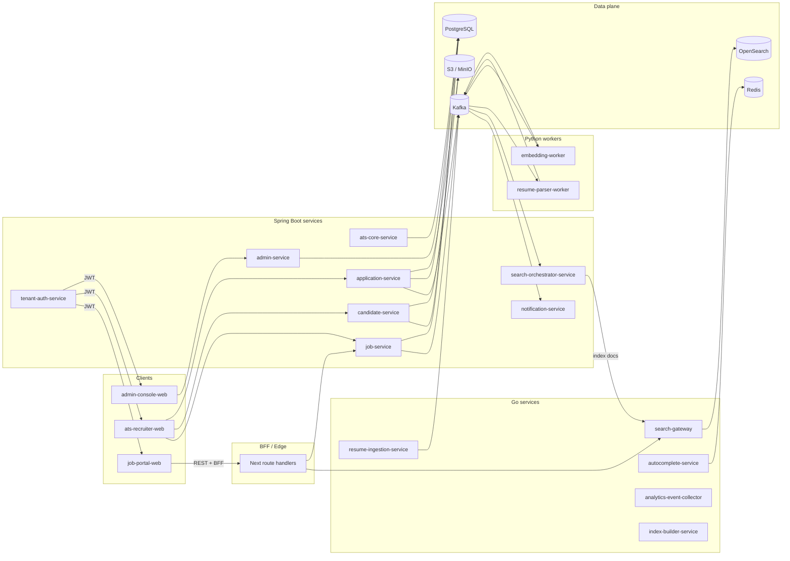

# 02 — Architecture

System architecture, deployment topology, technology choices, and the **current as-is snapshot** of the monorepo. Architecture decisions should be captured as ADRs once the team needs to record trade-offs explicitly.

## Files (current and planned)

| File | Purpose | Status |
|------|---------|--------|
| [`audit-as-is.md`](./audit-as-is.md) | Snapshot of what is actually implemented today across `services-java`, `services-go`, `workers-python`, `apps`, `packages`, and `infra`. Update on every meaningful change. | Authoritative |
| [`backend-modular-architecture.md`](./backend-modular-architecture.md) | Spring Boot module map: responsibilities, package layout, dependency rules, security and tenancy boundaries. | Authoritative |
| `system-architecture.md` | Macro view: clients → BFF → APIs → DB / Kafka / OpenSearch / S3, with deployment topology. | Planned |
| `frontend-architecture.md` | Next.js App Router layout, BFF routes, server vs client components, data fetching strategy. | Planned |
| `adr/` | Architecture Decision Records (ADR-0001…). | Planned |

## Tech stack (target)

| Layer | Choice | Notes |
|-------|--------|-------|
| Frontend | **Next.js 15 / React 19** + Tailwind 3 + `@jobocate/ui` (shadcn-derived) | TanStack Query to be added when client-side data fetching becomes substantial. |
| Backend | **Java 21 + Spring Boot 4.0.x** + Spring Security + Spring Data JPA + Spring Kafka | The PRD calls for Spring Boot 3.x; the repo already runs on 4.0.4. We document 4.x and call out the deviation. |
| Persistence | **PostgreSQL 16** with **Flyway** per-service histories | One logical DB per service in the long run; one shared DB acceptable in the modular-monolith starting point. |
| Search | **OpenSearch 2.17** via a **Go `search-gateway`** | Hybrid lexical + kNN. |
| Async | **Kafka** (Redpanda locally) + **transactional outbox** | Outbox is the next big addition (services currently send directly after save). |
| AI workers | **Python 3.12** | Stubs today; LLM/embedding providers behind feature flags. |
| Storage | **S3** (MinIO locally) | Resumes, AI artifacts, exports. |
| Cache | **Redis 7** | Autocomplete suggestions, rate limiting, ephemeral sessions. |
| Observability | OpenTelemetry → OTLP collector → Prometheus + Jaeger | Grafana dashboards described in [`15-observability/`](../15-observability/). |

## Macro service map

