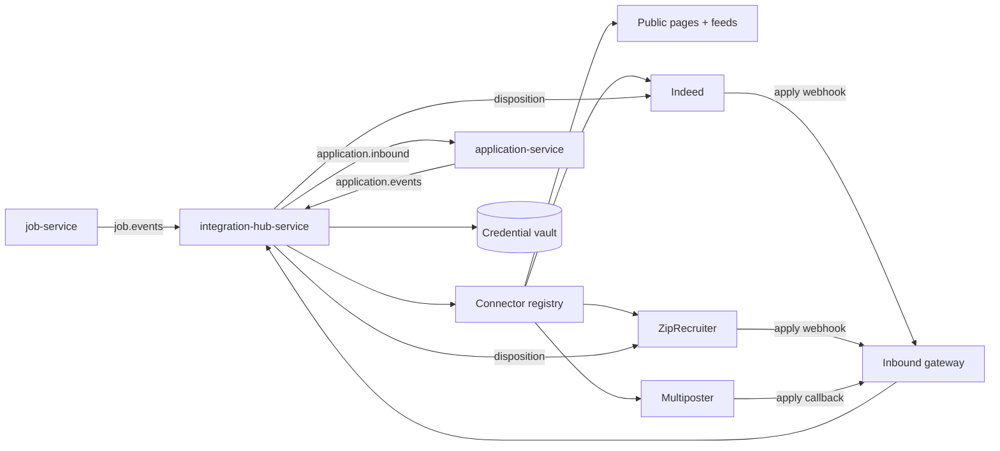

# Design — Job Board Hub

> **Document type:** System and experience design for product pillar 4.4 of the
> [product outline](../01-product/prd.md): job distribution and inbound applications.
> **Status:** Proposal for tech-lead review. Nothing here is built. **Jira:** IATS-132.
> **Change classes when implemented:** Contract, Data, Security, Operational, Product.
> **Builds on:** epic E15 (IATS-80) and its stories IATS-85 to IATS-95; E19 story IATS-121.
> **Evidence for the choices:** [`market-and-competitive-research.md` §4](../01-product/market-and-competitive-research.md).
> Facts about board programmes change often and several are marked unverified there; confirm each
> against the board's current documentation when its connector is built.

## 1. What changed since E15 was written

E15 names Indeed, LinkedIn, Dice and one multiposter as the first wave. Research on 2026-11-10
found:

- **LinkedIn's Job Posting API and Apply with LinkedIn are not accepting new partners.** A direct
  LinkedIn connector (IATS-88) cannot be the first deliverable. LinkedIn reach comes through the
  multiposter for now.
- **Indeed has stopped collecting single-source XML feeds organically** and needs partner
  onboarding for its API. That takes calendar time we do not control, so the application
  (IATS-94) should start immediately.
- **Google for Jobs needs no approval and no fee.** It should be first, not a later marketplace
  item.

Recommended order:

| Wave | Channels | Needs approval | Est. calendar risk |
|---|---|---|---|
| **0** | Public job pages with Google for Jobs markup; public JSON and XML feeds; aggregators (Jooble, Jora, Adzuna, Talent.com) | No | Low |
| **1** | Indeed (jobs, apply, screeners, disposition); ZipRecruiter | Partner onboarding | Board-controlled |
| **2** | Multiposter for LinkedIn and long-tail boards, including StepStone and Naukri where offered | Commercial contract | Vendor-controlled |
| **3** | Dice direct; Naukri and Monster/CareerBuilder direct; LinkedIn Apply Connect; sponsored-job budgets | Partnerships | High |

Dice moves to wave 3 only as a *direct* connector. It matters to the IT-staffing segment, so it
should be reachable in wave 2 through the multiposter or its career-site reader if either supports
it; IATS-95 should check this.

## 2. Architecture



- **`integration-hub-service`** (Java, new; IATS-85) owns postings, connector accounts, inbound
  application receipts and channel metrics. It follows the existing module layout and outbox
  pattern.
- **Connectors are plug-ins inside the hub** behind one interface. A connector contains only
  board-specific mapping and transport.
- **`job-service` stays the owner of the job.** The hub reacts to job events; it never edits jobs.
- **`application-service` stays the owner of applications.** The hub hands over a normalised
  inbound application and receives status events back for disposition sync.
- **Public pages** are served by `job-portal-web`; the hub only supplies the feed endpoints.

## 3. Connector contract

Each connector declares capabilities so the hub and the interface can adapt without special cases.

```
ConnectorDescriptor
  channelId, displayName, regions
  access:       requiresPartnerApproval, authModel (NONE | PARTNER_KEY | TENANT_OAUTH | TENANT_CREDENTIALS)
  publishing:   mode (PUSH_API | PULL_FEED | STRUCTURED_DATA | VIA_INTERMEDIARY)
                operations (CREATE, UPDATE, EXPIRE, STATUS)
                requiredFields, perCountryRules, htmlAllowList, maxLocationsPerJob
  apply:        mode (REDIRECT | HOSTED_WEBHOOK | PROFILE_PREFILL | POLL)
                signatureScheme, resumeFormats, screenerSchemaVersion, demographicQuestions
  disposition:  supported, expected, statusMapping
  commercial:   costModel (FREE | SLOT | CPC | CPA), supportsSponsorship, billedTo
  operations:   rateLimits, batchSize, errorTaxonomy, sunsetDate

Connector
  validate(job, account)        → list of problems, before anything is sent
  publish(posting)              → externalId
  update(posting)
  expire(posting)
  status(posting)               → LIVE | REJECTED(reason) | ...
  parseInbound(request)         → InboundApplication   (after signature check)
  sendDisposition(application, status)
  metrics(posting, range)       → impressions, clicks, applies, spend where available
```

## 4. Data model

```
connector_account      id, tenant_id, channel_id, status, auth_ref (vault pointer), scopes,
                       connected_by, connected_at, last_health_check
posting                id, tenant_id, job_id, job_version, channel_id, account_id,
                       external_id, state, sponsored, budget, last_error, published_at, expires_at
posting_event          id, posting_id, from_state, to_state, reason, at         (append-only)
inbound_receipt        id, tenant_id, channel_id, external_apply_id, posting_id, received_at,
                       payload_ref (object storage), status, application_id      (idempotency)
channel_metric_daily   tenant_id, posting_id, date, impressions, clicks, applies, spend
```

- Every table carries `tenant_id` and every query filters on it.
- `(tenant_id, channel_id, external_apply_id)` is unique, which makes webhook retries safe.
- Raw inbound payloads go to tenant-scoped object storage, not the database, with a retention
  period set by IATS-76.

### 4.1 Posting state machine

```
DRAFT → VALIDATING → QUEUED → LIVE ⇄ PAUSED
                 ↘ INVALID         ↘ EXPIRED | CLOSED
        QUEUED → FAILED (retry with backoff, then needs attention)
        LIVE   → REJECTED (board refused; reason shown to the recruiter)
```

Triggers: `job.published` creates postings for the channels selected on the job; `job.updated`
queues updates; `job.closed` and `job.unpublished` expire every posting. Closing a job must expire
all postings even if a board is down, so expiry retries until confirmed and raises an alert after a
set period.

## 5. Outbound: publishing

### 5.1 Wave 0 — pages and feeds

- **Job page.** Server-rendered at a stable URL with `JobPosting` JSON-LD: title, description,
  `datePosted`, `validThrough`, hiring organisation, location or remote fields, employment type, and
  `baseSalary` when present. One job per page.
- **Removal.** On close, the page returns 410 and the Indexing API is notified. Stale jobs are a
  policy violation for Google.
- **`directApply`** is set only when our apply flow is a single step without account creation.
- **Feeds.** `GET /public/v1/tenants/{slug}/jobs.json` and `.xml` list published jobs only. The XML
  follows the common aggregator layout (reference number, title, URL, company, location, salary, job
  type, dates). Reference numbers are stable for the life of a job and unique per location.
- **Agency confidentiality.** Staffing tenants often cannot name the end client. A job has a
  `public_employer_name` setting; where a channel does not permit confidential postings the
  validator says so before posting.
- **Tenant opt-out.** A tenant can exclude a job, or all jobs, from public pages and feeds.

### 5.2 Validation before posting

`validate()` runs for every selected channel when the recruiter clicks publish, and the result is
shown per channel:

- Required fields for the channel and country.
- **Pay transparency:** if the job's location is in a jurisdiction that requires a pay range, the
  range, currency and period are required, and benefits or an application deadline where the rule
  asks for them. The jurisdiction table is data maintained by compliance, not code.
- AI-use disclosure text where the jurisdiction requires it in postings (Ontario).
- Description length and permitted HTML.
- Duplicate check: the same job and location is not already live on that channel.

A job can still be published to the channels that pass.

### 5.3 Wave 1 — direct connectors

**Indeed**

- Jobs through the Job Sync API using per-employer OAuth; the hub batches within documented rate
  limits.
- **Indeed Apply:** the inbound gateway verifies the request signature, stores the payload, answers
  2xx quickly and processes asynchronously. A non-2xx answer causes retries from Indeed, which the
  idempotency key absorbs.
- **Screener questions** are mapped from the job's screening questions to Indeed's schema. Questions
  that cannot be represented are reported by `validate()`.
- **Disposition sync:** application status changes are mapped to Indeed's normalised statuses and
  sent with the Indeed apply ID.

**ZipRecruiter** follows the same shape: Jobs API, signed apply webhook, hiring signals for
disposition.

### 5.4 Wave 2 — multiposter

One connector with `mode = VIA_INTERMEDIARY`. The multiposter's channel catalogue is exposed in our
channel picker with its prices. Selection criteria for IATS-95: LinkedIn coverage, Dice and Naukri
coverage, whether applies return through an API with the original source preserved, disposition
support, pricing model, and data-processing terms.

## 6. Inbound: one pipeline

```mermaid
sequenceDiagram
  participant B as Board
  participant G as Inbound gateway
  participant H as Hub
  participant C as candidate-service
  participant A as application-service
  B->>G: POST apply (signed)
  G->>G: verify signature, resolve tenant from posting, store raw payload
  G-->>B: 200
  G->>H: inbound receipt (idempotent on external apply id)
  H->>C: find or create candidate within tenant; store resume
  H->>A: create application (source, posting, screener answers)
  A-->>H: application id
```

- **Tenant resolution** comes from our own posting record looked up by the external job ID, never
  from a field the caller controls. Webhook URLs contain no tenant identifier that would be trusted.
- **Signature verification** uses the scheme each board specifies, with constant-time comparison and
  per-connector secrets held in the vault.
- **Candidate de-duplication** is within one tenant only: normalised email, then phone, then resume
  content hash. A probable match is linked; an uncertain one is flagged for a recruiter to merge.
  Candidates are never matched across tenants.
- **One candidate, several boards.** A second application to the same job from another board is
  attached to the existing application as an additional source, not created as a duplicate. First
  source wins for attribution; all sources are kept.
- **Resume handling.** Files go through the same type, size and malware checks as direct uploads,
  then into the normal parsing and assessment flow.
- **Demographic answers** supplied by a board are stored separately from anything a reviewer or a
  scoring model can see.
- **Intake signals.** Duplicate bursts, the hidden-text flag from parsing and velocity anomalies are
  shown to the recruiter as neutral flags. They do not reject anyone.
- **Redirect applies** (Google, aggregators, feeds) land on our apply page with a source token in
  the URL, kept through sign-in and recorded on the application.

## 7. Credentials and security

- Board credentials and tokens live in a secrets manager; the database stores only a pointer.
  Tokens are never logged and never returned by an API.
- Connecting an account requires the tenant-admin role and is audited. Token refresh failures raise
  a tenant-visible "reconnect" state.
- The inbound gateway is the only public write surface. It is rate-limited per channel and per
  posting, accepts only known content types and sizes, and rejects unsigned requests where a scheme
  exists.
- Outbound calls are rate-limited per connector and per account, with retry, backoff and a
  dead-letter queue.
- **No scraping and no automation of recruiter sessions on any board.**

## 8. Reporting

Per job and per tenant, by channel: postings live, impressions and clicks where the board provides
them, applications, applications reaching a chosen stage, hires, spend, and cost per application and
per hire. Source of hire uses the first-source rule in §6. Feeds IATS-92 and IATS-55.

The useful comparison for recruiters is **quality by channel**: the share of each channel's
applicants who met the must-haves in their assessment. That links this pillar to the matching one.

## 9. Experience design

### 9.1 Publish

```
┌ Publish: Senior Backend Engineer ───────────────────────────────────────────────┐
│ ☑ Careers page + Google for Jobs        Free        ✔ Ready                     │
│ ☑ Job feeds (Jooble, Adzuna, …)         Free        ✔ Ready                     │
│ ☑ Indeed                                Free / sponsor ▸   ⚠ Pay range required │
│                                                         for Colorado  [Add]     │
│ ☐ ZipRecruiter                          Connect account ▸                       │
│ ☑ LinkedIn (via partner)                $ per post      ✔ Ready                 │
│                                                              [Publish to 4]     │
└──────────────────────────────────────────────────────────────────────────────────┘
```

### 9.2 After publishing

A channel panel on the job shows each posting's state, last sync, any board rejection with its
reason and a fix action, and the numbers from §8. A tenant-level "Channels" page lists connected
accounts and their health.

### 9.3 In the pipeline

Each applicant shows a source badge. Filtering and sorting by source are available in the applicant
list.

## 10. Operations

- **Metrics:** publish latency per channel, posting failures by error class, webhook verification
  failures, inbound processing lag, disposition backlog, token refresh failures.
- **Alerts:** a job closed more than a set time ago with a posting still live; webhook failure rate
  above threshold; a connector's error rate rising after a board API change.
- **Runbooks:** board outage, credential revocation, replaying inbound receipts from stored
  payloads, connector sunset.
- Each connector records the board API version it targets and a review date.

## 11. Delivery order

| Step | Deliverable | Backlog |
|---|---|---|
| 0 | Start partner applications (Indeed, ZipRecruiter) and the multiposter evaluation now | IATS-94, IATS-95 |
| 1 | Job fields for pay range, benefits, deadline, public employer name; validation rules | IATS-24 (extend) |
| 2 | Public job pages with structured data and removal on close | IATS-121 |
| 3 | Hub service, connector contract, posting state machine, feed connector | IATS-85 |
| 4 | Source tokens on apply; inbound gateway; de-duplication | IATS-91 |
| 5 | Credential vault and account connection | IATS-86 |
| 6 | Indeed connector including apply, screeners and disposition | IATS-87 |
| 7 | Multiposter connector | IATS-90 |
| 8 | ZipRecruiter connector | IATS-93 (split) |
| 9 | Channel reporting | IATS-92 |

Steps 1–4 need no third-party approval and give a usable result by themselves.

## 12. Open questions

1. Partner-programme acceptance criteria and timelines for Indeed and ZipRecruiter (IATS-94).
2. Multiposter choice and whether its pricing can be passed through (IATS-95).
3. Whether sponsored-job budgets are managed in our product or left to the board's own console at
   launch.
4. Monster/CareerBuilder and Naukri partner terms.
5. Retention period for raw inbound payloads (IATS-76).
6. Whether jobs appear on the Insyght public marketplace by default with opt-out, as E19 proposes,
   or by opt-in. Agencies with confidential clients may need opt-in.
