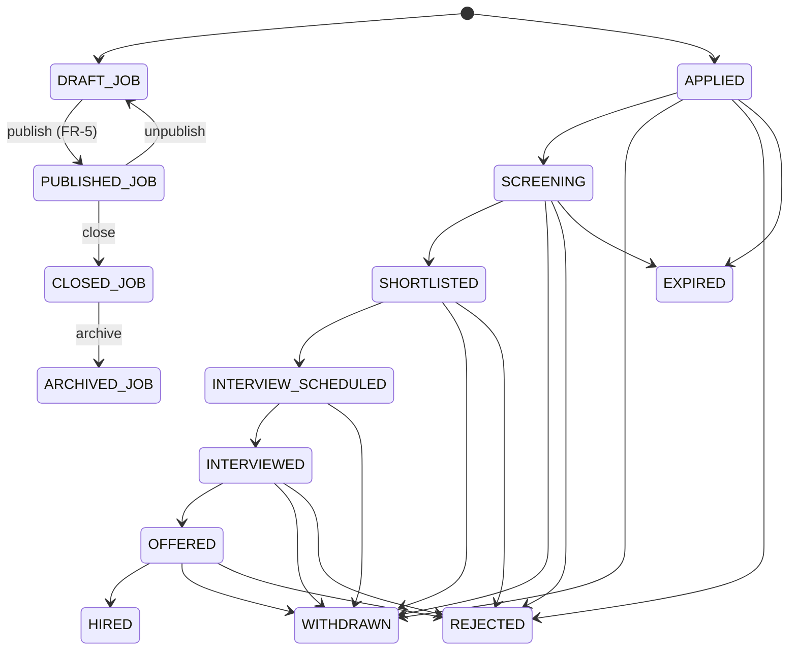

# Domain model

> **Document type:** Domain model specification (DDD-flavored).
> **Audience:** Backend engineers, search engineers, AI workers, schema reviewers.
> **Pairs with:** [`database-design.md`](./database-design.md) (physical Postgres design) and [`05-api-contracts/api-contract-plan.md`](../05-api-contracts/api-contract-plan.md) (API surface).

## 1. Conventions

- **IDs**: UUIDv4, generated server-side. Never trust client-supplied ids.
- **Tenant scope**: every business entity carries `tenant_id UUID NOT NULL`. Platform-global entities are tagged `(GLOBAL)` in the entity headers.
- **Lifecycle**: enumerated states stored as `VARCHAR(64)`. Transitions are documented in [`04-workflows/`](../04-workflows/).
- **Audit**: every mutation produces a row in the audit stream (`audit_events`) with actor, tenant, action, entity, before/after metadata, correlation id.
- **Optimistic locking**: `version BIGINT` mapped to JPA `@Version` on aggregate roots.
- **Soft delete**: `deleted_at TIMESTAMPTZ NULL` on entities where retention requires it.
- **Money**: integer cents (`BIGINT`) + `currency_code CHAR(3)`.

## 2. Bounded contexts and service ownership

| Bounded context | Service (current → target) | Aggregates owned |
|----|----|----|
| **Identity & Tenancy** | `tenant-auth-service` (issuer); `ats-core-service` (tenant aggregate) | Tenant, User, UserRole, RoleAssignment, ApiKey |
| **Candidate** | `candidate-service` | CandidateProfile, Resume, ResumeVariant, ConsentRecord, SavedSearch, AlertSubscription |
| **Job** | `job-service` | Job, JobSkill, ScreeningQuestion, HiringTeamMember |
| **Application & Pipeline** | `application-service` | Application, ApplicationTimelineEntry, Pipeline, PipelineStage, ApplicationNote, ApplicationTag, ApplicationRating |
| **Interview** | (new) `interview-service` (post-MVP) or extend `application-service` for MVP-lite | Interview, InterviewParticipant, InterviewFeedback |
| **Offer** | (new) `offer-service` (post-MVP) | Offer, OfferApproval, OfferDocument |
| **Notification** | `notification-service` | Notification, NotificationPreference |
| **AI Platform** | `application-service` (artifact metadata) + `workers-python` | AIArtifact |
| **Audit & Compliance** | All services write; `admin-service` reads | AuditEvent (write-once stream) |
| **Billing** | (new) `billing-service` (post-MVP) | SubscriptionPlan, TenantSubscription, Invoice, UsageRecord |
| **Search** | Read model only — `search-orchestrator-service` projects, `search-gateway` reads OpenSearch | (no DB ownership; index documents only) |

A **modular monolith** is acceptable starting point: keep the bounded contexts as Spring modules with strict package boundaries even if multiple modules deploy in one JVM during MVP.

## 3. Entity reference

> Every section below lists: **Purpose**, **Owning context**, **Tenant scope**, **Key fields**, **Relationships**, **Lifecycle**, **Search indexing**, **Audit**.

---

### 3.1 Tenant `(GLOBAL)`

- **Purpose**: A customer organization. Root of all multi-tenant scoping.
- **Owning context**: Identity & Tenancy.
- **Tenant scope**: Self.
- **Key fields**: `id`, `slug` (URL-safe unique), `legal_name`, `display_name`, `status` (`ACTIVE`, `SUSPENDED`, `DELETED`), `time_zone`, `default_locale`, `logo_url`, `primary_domain`, `brand_color_primary`, `brand_color_accent`, `billing_email`, `support_email`, `created_at`, `updated_at`, `deleted_at?`, `version`.
- **Relationships**: 1—N `User`, 1—N `Job`, 1—N `CandidateProfile` (when tenant-imported), 1—N `Pipeline`, 1—N `Subscription`.
- **Lifecycle**: `ACTIVE → SUSPENDED → ACTIVE` (Super Admin); `ACTIVE → DELETED` (soft-delete + scheduled purge).
- **Search indexing**: Not indexed (used as filter on every other index).
- **Audit**: Tenant create/update/suspend/delete.

### 3.2 Organization

- **Purpose**: An employer entity within a Tenant. A staffing-agency Tenant may host many Organizations (their clients); a single-employer Tenant has exactly one Organization.
- **Owning context**: Identity & Tenancy (or Job, depending on simplification — for MVP, Tenant ≅ Organization with `organization_id` always set to a tenant-default org id; introduce real multi-organization-per-tenant in post-MVP).
- **Tenant scope**: Yes.
- **Key fields**: `id`, `tenant_id`, `name`, `slug`, `industry`, `website`, `description`, `logo_url`, `headquarters_location`, `size_band` (`1_10`, `11_50`, …), `status`, audit columns.
- **Relationships**: 1—N `Job`. N—M with `User` via `OrganizationMembership` (post-MVP; for MVP, all tenant users are members of the default org).
- **Lifecycle**: `ACTIVE → ARCHIVED`.
- **Search indexing**: Embedded inside `JobSearchDocument.organization` for search filters.
- **Audit**: CRUD.

### 3.3 User

- **Purpose**: A human who logs in. A user may have roles in one or more tenants.
- **Owning context**: Identity & Tenancy.
- **Tenant scope**: User identity is **global**, but every login binds to one tenant context (selected on auth) and authorization is per (user, tenant) via `UserRole`.
- **Key fields**: `id`, `email` (case-insensitive unique globally), `password_hash` (bcrypt/argon2), `email_verified_at?`, `mfa_enabled`, `last_login_at?`, `locked_until?`, `failed_login_count`, `display_name`, `avatar_url?`, `time_zone`, `locale`, `created_at`, `updated_at`, `deleted_at?`, `version`.
- **Relationships**: N—M `Tenant` via `UserRole`.
- **Lifecycle**: `INVITED → ACTIVE → SUSPENDED → DELETED`.
- **Search indexing**: Not indexed publicly (PII).
- **Audit**: User CRUD, login events, password resets, MFA changes.

### 3.4 Role `(GLOBAL)`

- **Purpose**: Enumerated capability bundle.
- **Tenant scope**: Global enum.
- **Values**: `SUPER_ADMIN`, `TENANT_ADMIN`, `RECRUITER`, `HIRING_MANAGER`, `INTERVIEWER`, `CANDIDATE`, `FINANCE_ADMIN`, `COMPLIANCE_ADMIN`.
- **Implementation**: An `enum_roles` table or a static enum in code; recommended **static enum in code** plus a `user_roles` join table.

### 3.5 UserRole

- **Purpose**: Assigns a role to a user within a tenant.
- **Owning context**: Identity & Tenancy.
- **Tenant scope**: Yes.
- **Key fields**: `id`, `user_id`, `tenant_id`, `role` (enum), `granted_by_user_id`, `granted_at`, `revoked_at?`.
- **Relationships**: M—1 `User`, M—1 `Tenant`.
- **Lifecycle**: `ACTIVE → REVOKED`.
- **Audit**: Grant, revoke.

### 3.6 CandidateProfile

- **Purpose**: A candidate's persistent profile data.
- **Owning context**: Candidate.
- **Tenant scope**: A candidate **may exist outside any tenant** (marketplace-only candidate). When a candidate applies to a job, a (tenant_id, candidate_id) link is materialized. Two visibility models supported:
  - **Marketplace candidate**: `tenant_id IS NULL` on the profile; the profile is owned by the candidate user.
  - **Tenant-imported candidate** (post-MVP): `tenant_id` set; created via Resume DB import or recruiter add.
- **Key fields**: `id`, `user_id` (link to login User; nullable if recruiter-imported), `tenant_id?`, `full_name`, `headline`, `email`, `phone?`, `location_city?`, `location_region?`, `location_country?`, `summary`, `desired_role`, `salary_expectation_min_cents?`, `salary_expectation_max_cents?`, `currency_code?`, `availability` (`IMMEDIATE`, `WITHIN_2_WEEKS`, `WITHIN_30_DAYS`, `NOT_LOOKING`), `work_authorization?`, `links` (JSON), `profile_visibility` (`PUBLIC`, `TENANT_ONLY`, `PRIVATE`), `consent_searchable` (boolean), audit columns.
- **Relationships**: 1—1 `User` (optional). 1—N `Resume`. 1—N `WorkExperience`, 1—N `Education`, 1—N `Certification`. 1—N `ConsentRecord`. 1—N `Application`.
- **Lifecycle**: `ACTIVE → SUSPENDED → DELETED`.
- **Search indexing**: Indexed in `candidate-index` when `consent_searchable = true` and `profile_visibility != PRIVATE`. Removed when consent revoked.
- **Audit**: Profile changes, visibility/consent changes, deletion requests.

### 3.7 WorkExperience / Education / Certification

- **Purpose**: Structured profile sub-aggregates.
- **Owning context**: Candidate.
- **Tenant scope**: Inherits from `CandidateProfile`.
- **Key fields** (`WorkExperience`): `id`, `candidate_profile_id`, `company_name`, `title`, `started_at`, `ended_at?`, `current` (bool), `description`, `skills` (string array).
- **Key fields** (`Education`): `id`, `candidate_profile_id`, `institution`, `degree`, `field_of_study`, `started_at`, `ended_at?`, `gpa?`.
- **Key fields** (`Certification`): `id`, `candidate_profile_id`, `name`, `issuer`, `issued_at`, `expires_at?`, `credential_url?`.
- **Lifecycle**: Active or deleted (no soft state).
- **Search indexing**: Aggregated into the candidate index document (`skills`, `total_experience_years`, `education[]`, `certifications[]`).
- **Audit**: CRUD.

### 3.8 Resume

- **Purpose**: An uploaded resume document. Immutable after creation (a new upload creates a new resume row).
- **Owning context**: Candidate.
- **Tenant scope**: Inherits from `CandidateProfile`.
- **Key fields**: `id`, `candidate_profile_id`, `tenant_id?`, `original_filename`, `mime_type`, `size_bytes`, `s3_key`, `version_label`, `is_default` (boolean), `parser_status` (`PENDING`, `PARSED`, `FAILED`), `parsed_at?`, `parser_error?`, `created_at`, `created_by_user_id`.
- **Relationships**: 1—N `ResumeVariant`, 1—N `Application` (referenced as `resume_id_used`).
- **Lifecycle**: `PENDING → PARSED | FAILED`.
- **Search indexing**: `resume_text` aggregated into the candidate index document.
- **Audit**: Upload, parser completion, access (who viewed which resume).

### 3.9 ResumeVariant

- **Purpose**: An AI-generated tailored variant of a base resume.
- **Owning context**: Candidate (artifact also tracked in AI Platform via `AIArtifact`).
- **Tenant scope**: Inherits from `Resume`.
- **Key fields**: `id`, `resume_id`, `for_job_id`, `s3_key`, `prompt_version`, `model_version`, `status` (`DRAFT`, `READY_FOR_REVIEW`, `APPROVED`, `REJECTED`, `ARCHIVED`), `created_by_user_id`, `approved_by_user_id?`, `approved_at?`.
- **Relationships**: M—1 `Resume`, M—1 `Job`.
- **Lifecycle**: `DRAFT → READY_FOR_REVIEW → APPROVED | REJECTED → ARCHIVED`.
- **Search indexing**: Not indexed (private artifact).
- **Audit**: Create, approve, reject.

### 3.10 Job

- **Purpose**: An open role. Aggregate root for hiring activity.
- **Owning context**: Job.
- **Tenant scope**: Yes (`tenant_id`, `organization_id`).
- **Key fields**: `id`, `tenant_id`, `organization_id`, `title`, `slug` (SEO), `department?`, `description`, `responsibilities`, `qualifications`, `employment_type` (`FULL_TIME`, `PART_TIME`, `CONTRACT`, `INTERNSHIP`, `TEMPORARY`), `remote_policy` (`REMOTE_FIRST`, `HYBRID`, `ONSITE`), `experience_min_years`, `experience_max_years`, `salary_min_cents?`, `salary_max_cents?`, `currency_code?`, `location_city?`, `location_region?`, `location_country?`, `status` (`DRAFT`, `PUBLISHED`, `CLOSED`, `ARCHIVED`), `published_at?`, `closed_at?`, `pipeline_id?` (defaults to tenant default), `boost_score?` (sponsored), `created_by_user_id`, `created_at`, `updated_at`, `version`, `deleted_at?`.
- **Relationships**: 1—N `JobSkill`, 1—N `ScreeningQuestion`, 1—N `HiringTeamMember`, 1—N `Application`, M—1 `Pipeline`.
- **Lifecycle**: See [`04-workflows/job-lifecycle.md`](../04-workflows/) (`DRAFT → PUBLISHED → CLOSED → ARCHIVED`, with `PUBLISHED → DRAFT` for unpublish).
- **Search indexing**: `JobSearchDocument` (see [`packages/shared-contracts/schemas/job-index-document.schema.json`](../../packages/shared-contracts/schemas/job-index-document.schema.json)).
- **Audit**: Status changes, salary changes, hiring team changes, sponsored boost changes.

### 3.11 JobSkill

- **Purpose**: Required/preferred skill on a job (typed tags for search).
- **Owning context**: Job.
- **Tenant scope**: Inherits from `Job`.
- **Key fields**: `job_id`, `skill_name` (normalized), `requirement` (`REQUIRED`, `PREFERRED`).
- **Search indexing**: `JobSearchDocument.skills` (string array of names).

### 3.12 ScreeningQuestion

- **Purpose**: Pre-application question on a job.
- **Owning context**: Job.
- **Tenant scope**: Inherits from `Job`.
- **Key fields**: `id`, `job_id`, `position`, `question_text`, `question_type` (`SHORT_TEXT`, `LONG_TEXT`, `SINGLE_CHOICE`, `MULTI_CHOICE`, `BOOLEAN`, `NUMERIC`), `options` (JSON for choice types), `required` (boolean), `disqualifying_answer` (JSON, optional).
- **Lifecycle**: Active or deleted.
- **Audit**: Edit.

### 3.13 HiringTeamMember

- **Purpose**: User assignment to a job's hiring team with a per-job role.
- **Owning context**: Job.
- **Tenant scope**: Inherits from `Job`.
- **Key fields**: `job_id`, `user_id`, `team_role` (`RECRUITER`, `HIRING_MANAGER`, `INTERVIEWER`).
- **Audit**: Add, remove.

### 3.14 Application

- **Purpose**: A candidate's submission to a job. Aggregate root for the pipeline lifecycle.
- **Owning context**: Application & Pipeline.
- **Tenant scope**: Yes.
- **Key fields**: `id`, `tenant_id`, `job_id`, `candidate_profile_id`, `resume_id_used`, `cover_letter_text?`, `screening_answers` (JSON keyed by question id), `status` (FR-6 enum), `current_stage_id?`, `source` (`DIRECT`, `JOB_BOARD`, `IMPORT`, `REFERRAL`), `applied_at`, `submitted_via_idempotency_key`, `created_at`, `updated_at`, `version`.
- **Relationships**: M—1 `Job`. M—1 `CandidateProfile`. M—1 `Pipeline` (via the Job's pipeline at apply time, snapshot). 1—N `ApplicationTimelineEntry`. 1—N `ApplicationNote`. 1—N `ApplicationTag`. 1—N `ApplicationRating`. 0—N `Interview`.
- **Lifecycle**: See [`04-workflows/application-state-machine.md`](../04-workflows/application-state-machine.md). States: `DRAFT`, `APPLIED`, `SCREENING`, `SHORTLISTED`, `INTERVIEW_SCHEDULED`, `INTERVIEWED`, `OFFERED`, `HIRED`, `REJECTED`, `WITHDRAWN`, `EXPIRED`.
- **Uniqueness**: At most one **non-terminal** application per `(tenant_id, job_id, candidate_profile_id)`.
- **Search indexing**: An optional `application-index` for recruiter cross-job views (post-MVP).
- **Audit**: Every status change. Resume access on this application.

### 3.15 ApplicationTimelineEntry (a.k.a. ApplicationStage event)

- **Purpose**: Append-only log of every meaningful event on an application (status change, stage change, note added, interview scheduled, etc.).
- **Owning context**: Application & Pipeline.
- **Tenant scope**: Inherits.
- **Key fields**: `id`, `application_id`, `tenant_id`, `entry_type` (`STATUS_CHANGED`, `STAGE_CHANGED`, `NOTE_ADDED`, `INTERVIEW_SCHEDULED`, `OFFER_SENT`, `WITHDRAWN`, `REJECTED`), `from_value?`, `to_value?`, `actor_user_id?`, `actor_role?`, `metadata` (JSON), `created_at`.
- **Lifecycle**: Append-only.
- **Search indexing**: None.
- **Audit**: This *is* the timeline; also mirrored to `audit_events`.

### 3.16 Pipeline

- **Purpose**: Ordered set of stages for the hiring workflow.
- **Owning context**: Application & Pipeline.
- **Tenant scope**: Yes.
- **Key fields**: `id`, `tenant_id`, `name`, `is_default` (boolean; only one default per tenant), `created_at`, `updated_at`, `deleted_at?`, `version`.
- **Relationships**: 1—N `PipelineStage`. 1—N `Job` (via `Job.pipeline_id`).
- **Lifecycle**: `ACTIVE → ARCHIVED`.
- **Audit**: CRUD.

### 3.17 PipelineStage

- **Purpose**: A position in a pipeline.
- **Owning context**: Application & Pipeline.
- **Tenant scope**: Inherits.
- **Key fields**: `id`, `pipeline_id`, `position`, `name`, `color`, `disabled` (boolean), `terminal` (boolean — true for `Hired`, `Rejected` analogues if pipeline modeling chooses to fold terminal states into stages; otherwise terminal states are status enums on Application and stages are transient).
- **Recommended**: Keep terminal states on `Application.status` (cleaner) and treat stages as the transient progression. `terminal=false` for all stages, simplifying queries.
- **Lifecycle**: Active or disabled.
- **Audit**: CRUD, reorder, disable.

### 3.18 ApplicationNote

- **Purpose**: Recruiter / hiring manager note on an application.
- **Owning context**: Application & Pipeline.
- **Tenant scope**: Inherits.
- **Key fields**: `id`, `application_id`, `tenant_id`, `author_user_id`, `body_md`, `mentioned_user_ids` (UUID array), `created_at`, `updated_at`, `deleted_at?`.
- **Lifecycle**: Active, edited, soft-deleted.
- **Audit**: Create, edit, delete.

### 3.19 ApplicationTag

- **Purpose**: Free-form tag on an application (per tenant).
- **Owning context**: Application & Pipeline.
- **Tenant scope**: Inherits.
- **Key fields**: `id`, `application_id`, `tenant_id`, `tag` (lowercased), `created_by_user_id`, `created_at`.
- **Audit**: Create, delete.

### 3.20 ApplicationRating

- **Purpose**: Per-user rating on an application.
- **Owning context**: Application & Pipeline.
- **Tenant scope**: Inherits.
- **Key fields**: `id`, `application_id`, `rater_user_id`, `score` (1–5 or thumbs ±1 normalized to 1/5), `created_at`, `updated_at`.
- **Constraint**: Unique `(application_id, rater_user_id)` — one rating per rater per application.
- **Audit**: Create, change.

### 3.21 Interview

- **Purpose**: A scheduled interview event.
- **Owning context**: Interview.
- **Tenant scope**: Yes.
- **Key fields**: `id`, `tenant_id`, `application_id`, `interview_type` (`PHONE`, `VIDEO`, `ONSITE`, `TECHNICAL_TASK`), `scheduled_start_at`, `scheduled_end_at`, `time_zone`, `location?`, `meeting_link?`, `status` (`SCHEDULED`, `RESCHEDULED`, `CANCELLED`, `COMPLETED`), `cancellation_reason?`, audit columns.
- **Relationships**: 1—N `InterviewParticipant`, 1—N `InterviewFeedback`.
- **Lifecycle**: `SCHEDULED → (RESCHEDULED → SCHEDULED) | CANCELLED | COMPLETED`.
- **Audit**: Schedule, reschedule, cancel, complete.

### 3.22 InterviewParticipant

- **Purpose**: A user attending an interview (besides the candidate).
- **Owning context**: Interview.
- **Tenant scope**: Inherits.
- **Key fields**: `interview_id`, `user_id`, `role_at_interview` (`INTERVIEWER`, `OBSERVER`), `response` (`PENDING`, `ACCEPTED`, `DECLINED`).

### 3.23 InterviewFeedback

- **Purpose**: One interviewer's structured feedback for an interview.
- **Owning context**: Interview.
- **Tenant scope**: Inherits.
- **Key fields**: `id`, `interview_id`, `interviewer_user_id`, `recommendation` (`STRONG_HIRE`, `HIRE`, `NO_HIRE`, `STRONG_NO_HIRE`), `scorecard` (JSON, criteria → score), `comment_md`, `submitted_at`, audit columns.
- **Visibility**: Other interviewers' feedback is hidden until the viewer has submitted their own (or is Hiring Manager / Recruiter on the job).
- **Audit**: Submit, edit.

### 3.24 Offer

- **Purpose**: Formal offer to a candidate for a job.
- **Owning context**: Offer.
- **Tenant scope**: Yes.
- **Key fields**: `id`, `tenant_id`, `application_id`, `title`, `salary_cents`, `currency_code`, `start_date`, `terms_md`, `status` (`DRAFT`, `PENDING_APPROVAL`, `APPROVED`, `SENT`, `ACCEPTED`, `DECLINED`, `RESCINDED`, `EXPIRED`), `signed_url?`, `signed_url_expires_at?`, `responded_at?`, audit columns.
- **Relationships**: 1—N `OfferApproval`. 1—N `OfferDocument`.
- **Lifecycle**: `DRAFT → PENDING_APPROVAL → APPROVED → SENT → ACCEPTED | DECLINED | RESCINDED | EXPIRED`.
- **Audit**: Every transition, document upload, candidate response.

### 3.25 OfferApproval

- **Purpose**: One approver's decision on an offer.
- **Owning context**: Offer.
- **Tenant scope**: Inherits.
- **Key fields**: `id`, `offer_id`, `approver_user_id`, `decision` (`PENDING`, `APPROVED`, `REJECTED`), `reason?`, `decided_at?`.

### 3.26 OfferDocument

- **Purpose**: Attached file (offer letter PDF, signed copy).
- **Owning context**: Offer.
- **Tenant scope**: Inherits.
- **Key fields**: `id`, `offer_id`, `kind` (`OFFER_LETTER`, `SIGNED_OFFER`, `OTHER`), `s3_key`, `mime_type`, `size_bytes`, `uploaded_by_user_id`, `created_at`.

### 3.27 SavedSearch

- **Purpose**: A candidate's saved search criteria, optionally with alert subscription.
- **Owning context**: Candidate.
- **Tenant scope**: No (candidate-owned, marketplace-global).
- **Key fields**: `id`, `user_id`, `name`, `query_text?`, `filters_json`, `sort_key?`, `created_at`, `updated_at`.
- **Relationships**: 0—1 `AlertSubscription`.
- **Audit**: CRUD.

### 3.28 AlertSubscription

- **Purpose**: A delivery cadence for a saved search.
- **Owning context**: Candidate.
- **Key fields**: `id`, `saved_search_id`, `user_id`, `cadence` (`IMMEDIATE`, `DAILY`, `WEEKLY`), `last_run_at?`, `enabled` (boolean).
- **Lifecycle**: Enabled / disabled.
- **Audit**: CRUD.

### 3.29 Notification

- **Purpose**: A delivered or queued notification to a user.
- **Owning context**: Notification.
- **Tenant scope**: Yes.
- **Key fields**: `id`, `tenant_id?`, `recipient_user_id`, `type` (FR-16.1 enum), `channel` (`EMAIL`, `IN_APP`, `SMS`), `status` (`QUEUED`, `SENT`, `FAILED`, `SUPPRESSED`), `payload` (JSON), `attempt_count`, `last_attempted_at?`, `last_error?`, `created_at`, `read_at?`.
- **Lifecycle**: `QUEUED → SENT | FAILED | SUPPRESSED`.
- **Audit**: Send attempts, suppressions.

### 3.30 NotificationPreference

- **Purpose**: A user's per-(type × channel) opt-in.
- **Owning context**: Notification.
- **Tenant scope**: Per (user, tenant) when relevant; per user globally for marketplace candidate prefs.
- **Key fields**: `id`, `user_id`, `tenant_id?`, `notification_type`, `channel`, `enabled` (boolean), `cadence` (`IMMEDIATE`, `DAILY`, `OFF`).
- **Audit**: Change.

### 3.31 AIArtifact

- **Purpose**: Any AI-generated content with full lineage.
- **Owning context**: AI Platform (metadata stored alongside the owning aggregate; e.g., resume variant in candidate-service).
- **Tenant scope**: Yes.
- **Key fields**: `id`, `tenant_id`, `kind` (`RESUME_VARIANT`, `COVER_LETTER`, `CANDIDATE_SUMMARY`, `MATCH_EXPLANATION`, `INTERVIEW_QA`), `subject_entity_type` (`APPLICATION`, `JOB`, `CANDIDATE`), `subject_entity_id`, `prompt_version`, `model_version`, `inputs_json` (refs and parameters), `output_text?`, `output_s3_key?`, `status` (`DRAFT`, `READY_FOR_REVIEW`, `APPROVED`, `REJECTED`, `ARCHIVED`), `created_by_user_id`, `approved_by_user_id?`, `approved_at?`, `created_at`, `updated_at`.
- **Lifecycle**: `DRAFT → READY_FOR_REVIEW → APPROVED | REJECTED → ARCHIVED`.
- **Audit**: Every state change, plus model/prompt version change.

### 3.32 ConsentRecord

- **Purpose**: Immutable record of a candidate consent grant or revoke.
- **Owning context**: Candidate.
- **Tenant scope**: Yes when consent is tenant-scoped (e.g., visibility to a specific tenant); no when global (e.g., consent to platform AI usage).
- **Key fields**: `id`, `user_id`, `tenant_id?`, `consent_kind` (`SEARCHABLE`, `AI_TOOLS`, `MARKETING`, `DATA_PROCESSING_TOS`), `consent_value` (boolean), `policy_version`, `source` (`SIGNUP_PAGE`, `SETTINGS_PAGE`, `APPLY_FLOW`, `IMPORT`), `recorded_at`.
- **Lifecycle**: Append-only (each grant/revoke is a new row).
- **Audit**: This *is* an audit stream; mirrored to `audit_events`.

### 3.33 AuditEvent `(append-only)`

- **Purpose**: Immutable audit row for any meaningful action.
- **Owning context**: Audit & Compliance (writers everywhere).
- **Tenant scope**: Yes (`tenant_id` may be NULL only for platform-global Super Admin actions).
- **Key fields**: `id`, `tenant_id?`, `actor_user_id?`, `actor_role?`, `action` (e.g., `JOB_PUBLISHED`, `APPLICATION_REJECTED`), `entity_type`, `entity_id`, `correlation_id`, `request_id?`, `ip_address?`, `user_agent?`, `metadata` (JSON), `occurred_at`.
- **Lifecycle**: Append-only. No UPDATE / DELETE in normal flows.
- **Search indexing**: None (queried via dedicated search index post-MVP).
- **Audit**: Self.

### 3.34 SubscriptionPlan `(GLOBAL)`

- **Purpose**: Catalog entry for plans (TRIAL, STARTER, GROWTH, ENTERPRISE).
- **Tenant scope**: Global.
- **Key fields**: `id`, `code`, `name`, `monthly_price_cents`, `annual_price_cents`, `entitlements` (JSON: recruiter_seats, monthly_job_postings, ai_credits_monthly, sponsored_slots_monthly, resume_db_access bool), `is_active`.
- **Lifecycle**: Active / archived.

### 3.35 TenantSubscription

- **Purpose**: Active subscription for a tenant.
- **Owning context**: Billing.
- **Tenant scope**: Yes.
- **Key fields**: `id`, `tenant_id`, `subscription_plan_id`, `stripe_customer_id`, `stripe_subscription_id`, `status` (`TRIALING`, `ACTIVE`, `PAST_DUE`, `CANCELLED`), `current_period_start`, `current_period_end`, `cancel_at_period_end` (boolean), audit columns.
- **Audit**: All transitions.

### 3.36 Invoice

- **Purpose**: A billing line item.
- **Owning context**: Billing.
- **Tenant scope**: Yes.
- **Key fields**: `id`, `tenant_id`, `tenant_subscription_id`, `stripe_invoice_id`, `period_start`, `period_end`, `amount_cents`, `currency_code`, `status` (`DRAFT`, `OPEN`, `PAID`, `VOID`, `UNCOLLECTIBLE`), `pdf_url?`, audit columns.
- **Audit**: Create, status changes.

### 3.37 UsageRecord

- **Purpose**: Per-tenant usage event for metered features (AI credits, sponsored impressions).
- **Owning context**: Billing.
- **Tenant scope**: Yes.
- **Key fields**: `id`, `tenant_id`, `usage_kind` (`AI_CREDIT`, `SPONSORED_IMPRESSION`, `JOB_POSTED`), `quantity`, `recorded_at`, `metadata` (JSON).
- **Audit**: Append-only.

## 4. Aggregate boundaries

The transactional consistency boundaries (i.e., a single DB transaction may write across these in one go):

```
Tenant
   └── Organization
   └── User (global; per-tenant role grants are separate aggregate)
   └── UserRole
Pipeline
   └── PipelineStage
Job
   └── JobSkill
   └── ScreeningQuestion
   └── HiringTeamMember
CandidateProfile
   └── WorkExperience
   └── Education
   └── Certification
   └── Resume
        └── ResumeVariant (also in AI Platform)
   └── ConsentRecord (append-only; cross-aggregate read but write here)
Application
   └── ApplicationTimelineEntry (append-only)
   └── ApplicationNote
   └── ApplicationTag
   └── ApplicationRating
Interview
   └── InterviewParticipant
   └── InterviewFeedback
Offer
   └── OfferApproval
   └── OfferDocument
Notification (no children)
NotificationPreference (no children)
AIArtifact (no children)
SubscriptionPlan (no children; global)
TenantSubscription
Invoice (linked to TenantSubscription)
UsageRecord (no children)
AuditEvent (append-only; everyone writes)
```

Cross-aggregate consistency (e.g., advancing an `Application` and creating an `Interview`) is achieved via **domain events through the outbox**, not by spanning aggregate transactions.

## 5. Event ownership (Kafka topics)

| Topic | Producer service | Event types | Consumers |
|----|----|----|----|
| `jobocate.tenant.events` | `ats-core-service` | `tenant.created`, `tenant.updated`, `tenant.suspended`, `tenant.deleted` | notification, search-orchestrator (provisioning) |
| `jobocate.user.events` | `tenant-auth-service` (or new identity service) | `user.created`, `user.invited`, `user.activated`, `user.password_reset`, `user.role_granted`, `user.role_revoked`, `user.suspended` | notification, audit |
| `jobocate.job.events` | `job-service` | `job.created`, `job.updated`, `job.published`, `job.unpublished`, `job.closed`, `job.reopened`, `job.archived` | search-orchestrator, notification |
| `jobocate.application.events` | `application-service` | `application.submitted`, `application.stage_changed`, `application.rejected`, `application.withdrawn`, `application.note_added`, `application.tagged` | notification, search-orchestrator (cross-job recruiter view) |
| `jobocate.interview.events` | `application-service` (or `interview-service`) | `interview.scheduled`, `interview.rescheduled`, `interview.cancelled`, `interview.completed`, `interview.feedback_submitted` | notification, calendar adapter |
| `jobocate.offer.events` | `offer-service` (post-MVP) | `offer.drafted`, `offer.sent`, `offer.accepted`, `offer.declined`, `offer.rescinded` | notification, application-service (move to HIRED) |
| `jobocate.resume.raw` | `resume-ingestion-service` | `resume.uploaded` | resume-parser-worker |
| `jobocate.resume.parsed` | `resume-parser-worker` | `resume.parsed`, `resume.parse_failed` | candidate-service (apply structured fields), search-orchestrator (refresh candidate index) |
| `jobocate.embedding.request` / `.ready` | various producers / `embedding-worker` | `embedding.request`, `embedding.ready` | search-orchestrator (apply vectors), AI artifact pipelines |
| `jobocate.ai.artifact.events` | `application-service` (artifact owner) | `ai.artifact.drafted`, `ai.artifact.approved`, `ai.artifact.rejected` | notification, audit |
| `jobocate.notification.events` | `notification-service` | `notification.sent`, `notification.failed` | audit |
| `jobocate.billing.events` | `billing-service` (post-MVP) | `subscription.created`, `subscription.updated`, `invoice.created`, `invoice.paid`, `usage.recorded` | audit, admin-service |
| `jobocate.analytics.events` | All clients via `analytics-event-collector` | UI events | analytics warehouse (post-MVP) |

All events carry: `event_id` (UUID for dedupe), `event_type`, `tenant_id`, `occurred_at` (UTC ISO-8601), `producer` (service id + version), `correlation_id`, `payload`. Outbox-pattern delivery (see [`02-architecture/backend-modular-architecture.md`](../02-architecture/backend-modular-architecture.md)) guarantees at-least-once.

## 6. Search index documents

- **`job-index`**: see [`packages/shared-contracts/schemas/job-index-document.schema.json`](../../packages/shared-contracts/schemas/job-index-document.schema.json). Document id = `job_id`. Tenant filter mandatory at query time.
- **`candidate-index`**: see [`packages/shared-contracts/schemas/candidate-index-document.schema.json`](../../packages/shared-contracts/schemas/candidate-index-document.schema.json) (added by Prompt 11). Tenant + consent filters mandatory.
- **`application-index`** (post-MVP): for cross-job recruiter views (e.g., "all candidates I shortlisted last 30 days"). Source: `application` + `application_timeline_entry` + `candidate` snapshots.

## 7. PII handling per entity

| Entity | PII fields | Handling |
|----|----|----|
| User | email, password_hash, last_login_ip | Email hashed for analytics; password hashed (bcrypt/argon2); IP redacted from operational logs. |
| CandidateProfile | full_name, email, phone, location | Masked in non-audit logs; never indexed publicly without consent. |
| Resume | resume content (S3) | S3 SSE-encrypted; access logged in audit table. |
| Notification | payload (may contain candidate name) | Retention purge per policy; don't log payload bodies in operational logs. |
| AuditEvent | actor_user_id, ip_address, user_agent, metadata | Inside audit table; export only by Compliance Admin. |

## 8. Lifecycle summary



(Application states; full transition table with actors and side effects in [`04-workflows/application-state-machine.md`](../04-workflows/application-state-machine.md).)

## 9. Open design questions

| # | Question | Recommendation |
|---|---|---|
| 1 | Should `Tenant` and `Organization` be merged for MVP? | Yes — single `Organization` per tenant for MVP; introduce multi-org for staffing agencies post-MVP. |
| 2 | Should marketplace candidate vs tenant-imported candidate be one entity or two? | One entity (`CandidateProfile`) with nullable `tenant_id`; a `CandidateTenantLink` table materializes recruiter visibility per tenant when applied/imported. |
| 3 | Do we keep terminal states on `Application.status` or fold into `PipelineStage`? | Keep on `Application.status` (cleaner queries and reporting). |
| 4 | Per-job pipeline override — snapshot at apply time, or live reference? | Snapshot the pipeline id on the application and **freeze stages** at apply time (avoids reorders breaking timelines). |
| 5 | Audit table location — single global table or per-service? | Single global table, partitioned by month (Postgres declarative partitioning) once volume warrants. Owned by audit module; written by every service. |
