# Application state machine

> **Document type:** Authoritative state machine for the candidate application lifecycle.
> **Audience:** Backend (`application-service`), frontend (recruiter ATS, candidate portal), notification, search projection, audit, QA.
> **Linked code (target):** `services-java/application-service`.
> **Linked entities:** `Application`, `ApplicationTimelineEntry` (see [`03-domain-model/domain-model.md`](../03-domain-model/domain-model.md)).
> **Linked APIs:** `application-api.yaml`, `notification-api.yaml`, search projections (see [`05-api-contracts/`](../05-api-contracts/)).

## 1. States

| State | Terminal? | Visibility |
|-------|-----------|------------|
| `DRAFT` | No | Candidate only. Internal staging used by AI packet flow (FR-12); never visible to recruiter. |
| `APPLIED` | No | Visible to recruiter team for the job. |
| `SCREENING` | No | Recruiter actively reviewing. |
| `SHORTLISTED` | No | Recruiter has marked candidate as a strong contender. |
| `INTERVIEW_SCHEDULED` | No | At least one interview is scheduled and not yet completed. |
| `INTERVIEWED` | No | All scheduled interviews have completed and feedback is captured. |
| `OFFERED` | No | An offer has been sent to the candidate (Offer aggregate exists). |
| `HIRED` | **Yes** | Candidate accepted offer. |
| `REJECTED` | **Yes** | Recruiter rejected (with disposition reason). |
| `WITHDRAWN` | **Yes** | Candidate withdrew. |
| `EXPIRED` | **Yes** | System closed due to job closure or inactivity policy. |

> **Terminal states** cannot transition further. Reopening requires creating a *new* application (a candidate may reapply if the previous app is terminal — guarded by FR-6.4 unique constraint). Status enum is `VARCHAR(64)` per [`03-domain-model/database-design.md`](../03-domain-model/database-design.md) §2.

## 2. Diagram

```mermaid
stateDiagram-v2
  [*] --> DRAFT: candidate starts AI packet (optional)
  [*] --> APPLIED: candidate submits (FR-6.1)
  DRAFT --> APPLIED: candidate approves AI packet & submits
  DRAFT --> WITHDRAWN: candidate discards
  APPLIED --> SCREENING: recruiter starts review
  APPLIED --> REJECTED: recruiter rejects
  APPLIED --> WITHDRAWN: candidate withdraws
  APPLIED --> EXPIRED: job closed / inactivity policy
  SCREENING --> SHORTLISTED: recruiter shortlists
  SCREENING --> REJECTED: recruiter rejects
  SCREENING --> WITHDRAWN: candidate withdraws
  SCREENING --> EXPIRED: job closed / inactivity policy
  SHORTLISTED --> INTERVIEW_SCHEDULED: interview scheduled
  SHORTLISTED --> REJECTED: recruiter rejects
  SHORTLISTED --> WITHDRAWN: candidate withdraws
  INTERVIEW_SCHEDULED --> INTERVIEWED: all required feedback submitted
  INTERVIEW_SCHEDULED --> INTERVIEW_SCHEDULED: rescheduled (self-loop allowed; same scheduled state)
  INTERVIEW_SCHEDULED --> WITHDRAWN: candidate withdraws
  INTERVIEW_SCHEDULED --> REJECTED: recruiter cancels & rejects
  INTERVIEWED --> OFFERED: recruiter creates and sends offer
  INTERVIEWED --> SHORTLISTED: more interviews needed
  INTERVIEWED --> REJECTED: recruiter rejects
  INTERVIEWED --> WITHDRAWN: candidate withdraws
  OFFERED --> HIRED: candidate accepts offer
  OFFERED --> REJECTED: candidate declines & recruiter rejects, OR recruiter rescinds
  OFFERED --> WITHDRAWN: candidate withdraws
  HIRED --> [*]
  REJECTED --> [*]
  WITHDRAWN --> [*]
  EXPIRED --> [*]
```

## 3. Transitions

Every transition row below is a contract. The canonical fields are: **From → To**, **Actor (role)**, **Trigger (API or system)**, **Pre-conditions**, **Validation**, **Persistence side-effects**, **Kafka event(s)**, **Notifications**, **Audit event**, **Search projection effect**.

> Where the spec says "via outbox", the row write and the outbox row write happen in the **same DB transaction**; the publisher loop emits to Kafka with at-least-once delivery.

### 3.1 `[*] → DRAFT`
- **Actor:** `CANDIDATE`.
- **Trigger:** `POST /api/v1/applications` with `status: DRAFT` (or default when AI packet flow used).
- **Pre-conditions:** authenticated candidate; job exists and is `PUBLISHED`; no non-terminal application exists for `(tenant, job, candidate)`.
- **Validation:** required fields per FR-6.3 not yet enforced (DRAFT may be incomplete).
- **Persistence:** insert `applications` row with `status='DRAFT'`, `applied_at=now()`.
- **Kafka:** none (DRAFT is private to candidate; no event).
- **Notifications:** none.
- **Audit:** `APPLICATION_DRAFTED`.
- **Search:** none.

### 3.2 `[*] → APPLIED` (direct submit, no AI packet)
- **Actor:** `CANDIDATE`.
- **Trigger:** `POST /api/v1/applications` with full payload + `Idempotency-Key`.
- **Pre-conditions:** authenticated; job is `PUBLISHED` and not soft-deleted; no non-terminal application; required screening questions answered; resume reference is valid.
- **Validation:** all required fields present (resume id, screening answers, optional cover letter); `Idempotency-Key` present (FR-6.5); duplicate detection (FR-6.4).
- **Persistence:** insert `applications` with `status='APPLIED'`, `applied_at=now()`, `resume_id_used=...`, `submitted_via_idempotency_key=...`. Insert `application_timeline_entries` `STATUS_CHANGED null→APPLIED`.
- **Kafka (via outbox):** `application.submitted` on `jobocate.application.events`.
- **Notifications:** in-app + email to candidate (`APPLICATION_SUBMITTED`); in-app to recruiters on hiring team (`APPLICATION_RECEIVED`).
- **Audit:** `APPLICATION_SUBMITTED`.
- **Search:** if `application-index` exists (post-MVP), upsert document with `status=APPLIED`.

### 3.3 `DRAFT → APPLIED` (candidate approves AI packet & submits)
- Same as 3.2 except the source is the candidate's existing DRAFT row; UPDATE rather than INSERT; `applied_at=now()` is set on transition; `Idempotency-Key` still required.

### 3.4 `DRAFT → WITHDRAWN` (candidate discards draft)
- **Actor:** `CANDIDATE`.
- **Trigger:** `DELETE /api/v1/applications/{id}` or `POST /api/v1/applications/{id}/withdraw`.
- **Persistence:** UPDATE status to `WITHDRAWN`; insert timeline entry `STATUS_CHANGED DRAFT→WITHDRAWN`.
- **Kafka:** none (DRAFT was never visible to recruiter).
- **Notifications:** none.
- **Audit:** `APPLICATION_WITHDRAWN`.
- **Search:** none.

### 3.5 `APPLIED → SCREENING`
- **Actor:** `RECRUITER`, `HIRING_MANAGER`, `TENANT_ADMIN`.
- **Trigger:** `PATCH /api/v1/applications/{id}/status` with `to: SCREENING`, optional `note`.
- **Pre-conditions:** actor is on hiring team for the job (or Tenant Admin); current status = `APPLIED`.
- **Validation:** transition is allowed (table 4); If-Match header (ETag/version) for optimistic locking.
- **Persistence:** UPDATE `status`; insert timeline entry; optionally set `current_stage_id` to first stage of pipeline.
- **Kafka (via outbox):** `application.stage_changed` with `from='APPLIED'`, `to='SCREENING'`.
- **Notifications:** candidate gets `APPLICATION_STATUS_CHANGED` (per their preferences).
- **Audit:** `APPLICATION_STATUS_CHANGED`.
- **Search:** if `application-index` exists, update `status` field.

### 3.6 `SCREENING → SHORTLISTED`
- **Actor / trigger / persistence**: same shape as 3.5 with `to: SHORTLISTED`.
- **Notifications:** candidate gets `APPLICATION_STATUS_CHANGED`; recruiters on hiring team get `CANDIDATE_SHORTLISTED`.

### 3.7 `SHORTLISTED → INTERVIEW_SCHEDULED`
- **Actor:** `RECRUITER`, `HIRING_MANAGER`.
- **Trigger:** `POST /api/v1/applications/{id}/interviews` (creating an Interview also moves the application). Direct status PATCH not allowed for this transition.
- **Pre-conditions:** at least one Interview row created for the application.
- **Persistence:** insert Interview, update application status, insert timeline entry `INTERVIEW_SCHEDULED` and `STATUS_CHANGED`.
- **Kafka:** `interview.scheduled` (interview events topic) + `application.stage_changed`.
- **Notifications:** candidate `INTERVIEW_SCHEDULED`; interviewers `INTERVIEW_SCHEDULED`; ICS attachment when calendar integration is on.
- **Audit:** `APPLICATION_STATUS_CHANGED`, `INTERVIEW_CREATED`.
- **Search:** none for application-index.

### 3.8 `INTERVIEW_SCHEDULED → INTERVIEW_SCHEDULED` (reschedule)
- **Actor:** `RECRUITER`, `HIRING_MANAGER`, or `CANDIDATE` (request).
- **Trigger:** `PATCH /api/v1/interviews/{id}/reschedule` with new time.
- **Persistence:** UPDATE Interview times; insert timeline entry `INTERVIEW_RESCHEDULED`.
- **Kafka:** `interview.rescheduled`.
- **Notifications:** candidate + interviewers.
- **Audit:** `INTERVIEW_RESCHEDULED`. No `STATUS_CHANGED` row.

### 3.9 `INTERVIEW_SCHEDULED → INTERVIEWED`
- **Actor:** system (when all required interviewers submit feedback) or `RECRUITER` manual override.
- **Trigger:** `POST /api/v1/interviews/{id}/feedback` (last required submission triggers transition); or `PATCH /api/v1/applications/{id}/status` to `INTERVIEWED` by recruiter.
- **Pre-conditions:** all required interviewers have submitted feedback (or manual override flagged).
- **Persistence:** UPDATE Interview status to `COMPLETED`; UPDATE application status; insert timeline entry.
- **Kafka:** `interview.completed`, `application.stage_changed`.
- **Notifications:** recruiters get `INTERVIEW_FEEDBACK_COMPLETE`.
- **Audit:** `INTERVIEW_COMPLETED`, `APPLICATION_STATUS_CHANGED`.
- **Search:** none.

### 3.10 `INTERVIEWED → SHORTLISTED` (more interviews needed)
- **Actor:** `RECRUITER`, `HIRING_MANAGER`.
- **Trigger:** `PATCH /api/v1/applications/{id}/status` `to: SHORTLISTED` with reason "additional rounds".
- **Persistence:** revert status; create new Interview later → 3.7.
- **Kafka:** `application.stage_changed`.
- **Notifications:** candidate `APPLICATION_STATUS_CHANGED`.
- **Audit:** `APPLICATION_STATUS_CHANGED`.

### 3.11 `INTERVIEWED → OFFERED`
- **Actor:** `RECRUITER`, `HIRING_MANAGER` (with offer creation permissions per RBAC).
- **Trigger:** `POST /api/v1/applications/{id}/offers` (Offer creation) followed by `POST /api/v1/offers/{id}/send` to flip the offer to SENT, which transitions the application.
- **Pre-conditions:** Offer aggregate created and approved; current application status = `INTERVIEWED`.
- **Persistence:** UPDATE application status to `OFFERED`; insert timeline entry `OFFER_SENT`.
- **Kafka:** `offer.sent`, `application.stage_changed`.
- **Notifications:** candidate `OFFER_SENT`.
- **Audit:** `OFFER_SENT`, `APPLICATION_STATUS_CHANGED`.

### 3.12 `OFFERED → HIRED`
- **Actor:** `CANDIDATE` (acceptance) or `RECRUITER` (manual confirmation).
- **Trigger:** `POST /api/v1/offers/{id}/accept` (candidate) or `PATCH /api/v1/applications/{id}/status` `to: HIRED`.
- **Pre-conditions:** Offer status = `SENT` or `ACCEPTED`.
- **Persistence:** UPDATE Offer to `ACCEPTED`; UPDATE application to `HIRED`; insert timeline entry; close other non-terminal applications for this candidate to **the same job** (none should exist due to the unique partial index — defensive).
- **Kafka:** `offer.accepted`, `application.stage_changed`.
- **Notifications:** recruiters + hiring team `CANDIDATE_HIRED`; candidate `OFFER_ACCEPTED_CONFIRMATION`.
- **Audit:** `OFFER_ACCEPTED`, `APPLICATION_HIRED`.
- **Search:** if `application-index` exists, mark application `HIRED`.

### 3.13 `* → REJECTED` (recruiter)
- **Actor:** `RECRUITER`, `HIRING_MANAGER`, `TENANT_ADMIN`.
- **Trigger:** `POST /api/v1/applications/{id}/reject` with `disposition_reason_code` (from tenant catalog) and optional `note_md`.
- **Pre-conditions:** current status is non-terminal and not `DRAFT` (DRAFT cannot be rejected, only withdrawn by candidate).
- **Validation:** `disposition_reason_code` must exist in tenant's catalog.
- **Persistence:** UPDATE status to `REJECTED`; insert timeline entry; optionally generate AI rejection email draft (FR-13.8).
- **Kafka:** `application.rejected` with `disposition_reason_code`.
- **Notifications:** candidate `APPLICATION_STATUS_CHANGED` (with rejection-aware copy and optional recruiter-personalized message).
- **Audit:** `APPLICATION_REJECTED`.
- **Search:** mark `REJECTED` if indexed.

### 3.14 `* → WITHDRAWN` (candidate)
- **Actor:** `CANDIDATE` (only the application's owner).
- **Trigger:** `POST /api/v1/applications/{id}/withdraw` with optional reason.
- **Pre-conditions:** current status is non-terminal.
- **Persistence:** UPDATE status to `WITHDRAWN`; insert timeline entry.
- **Kafka:** `application.withdrawn`.
- **Notifications:** recruiters get `CANDIDATE_WITHDREW`.
- **Audit:** `APPLICATION_WITHDRAWN`.
- **Search:** mark `WITHDRAWN` if indexed.

### 3.15 `* → EXPIRED` (system)
- **Actor:** system (scheduled task or event handler on `job.closed`).
- **Trigger:** `job.closed` event, or inactivity policy job (e.g., 90 days no recruiter action).
- **Pre-conditions:** job has been closed OR application has been in a non-terminal state past the inactivity threshold AND not currently `OFFERED` or `INTERVIEW_SCHEDULED`.
- **Persistence:** UPDATE status to `EXPIRED`; insert timeline entry with reason (`JOB_CLOSED` or `INACTIVITY`).
- **Kafka:** `application.expired`.
- **Notifications:** candidate `APPLICATION_STATUS_CHANGED`; recruiters not notified (bulk system action).
- **Audit:** `APPLICATION_EXPIRED`.

## 4. Allowed transition matrix

Rows = `from`, columns = `to`. ✓ allowed; ✗ disallowed; *(R)* recruiter, *(C)* candidate, *(S)* system, *(O)* offer-driven.

| from \ to | APPLIED | SCREENING | SHORTLISTED | INTERVIEW_SCHEDULED | INTERVIEWED | OFFERED | HIRED | REJECTED | WITHDRAWN | EXPIRED |
|----------|--------|-----------|-------------|---------------------|-------------|---------|-------|----------|-----------|---------|
| DRAFT     | ✓ (C)  | ✗         | ✗           | ✗                   | ✗           | ✗       | ✗     | ✗        | ✓ (C)     | ✗       |
| APPLIED   | —      | ✓ (R)     | ✗           | ✗                   | ✗           | ✗       | ✗     | ✓ (R)    | ✓ (C)     | ✓ (S)   |
| SCREENING | ✗      | —         | ✓ (R)       | ✗                   | ✗           | ✗       | ✗     | ✓ (R)    | ✓ (C)     | ✓ (S)   |
| SHORTLISTED | ✗    | ✗         | —           | ✓ (R, via Interview)| ✗           | ✗       | ✗     | ✓ (R)    | ✓ (C)     | ✓ (S)   |
| INTERVIEW_SCHEDULED | ✗ | ✗      | ✗           | ✓ self-loop reschedule | ✓ (S/R)  | ✗       | ✗     | ✓ (R)    | ✓ (C)     | ✓ (S)   |
| INTERVIEWED | ✗   | ✗         | ✓ (R)       | ✗ (need new sched=>3.10 then 3.7) | — | ✓ (R, via Offer) | ✗ | ✓ (R) | ✓ (C) | ✓ (S) |
| OFFERED    | ✗    | ✗         | ✗           | ✗                   | ✗           | —       | ✓ (C/O) | ✓ (R)  | ✓ (C)     | ✓ (S)   |
| HIRED      | ✗    | ✗         | ✗           | ✗                   | ✗           | ✗       | —     | ✗        | ✗         | ✗       |
| REJECTED   | ✗    | ✗         | ✗           | ✗                   | ✗           | ✗       | ✗     | —        | ✗         | ✗       |
| WITHDRAWN  | ✗    | ✗         | ✗           | ✗                   | ✗           | ✗       | ✗     | ✗        | —         | ✗       |
| EXPIRED    | ✗    | ✗         | ✗           | ✗                   | ✗           | ✗       | ✗     | ✗        | ✗         | —       |

## 5. Error handling

| Scenario | HTTP | Error code | Notes |
|----------|------|-----------|-------|
| Disallowed transition (e.g., `HIRED → APPLIED`) | 409 | `APPLICATION_TRANSITION_NOT_ALLOWED` | response includes `from`, attempted `to`, allowed `to[]`. |
| Actor lacks role for transition | 403 | `FORBIDDEN_ROLE` | |
| Optimistic lock failure (stale `If-Match`) | 409 | `OPTIMISTIC_LOCK_CONFLICT` | response includes current `version`. |
| Duplicate application (FR-6.4) | 409 | `APPLICATION_DUPLICATE` | response includes existing `application_id`. |
| Missing `Idempotency-Key` on submission | 400 | `IDEMPOTENCY_KEY_REQUIRED` | |
| Idempotency key replay with different payload | 409 | `IDEMPOTENCY_KEY_PAYLOAD_MISMATCH` | |
| Job not in `PUBLISHED` status when applying | 409 | `JOB_NOT_OPEN` | |
| Tenant suspended | 403 | `TENANT_SUSPENDED` | |
| Job soft-deleted | 404 | `JOB_NOT_FOUND` | |

## 6. Side-effect summary table

| Event | DB writes (same TX) | Outbox event | Notifications | Search projection |
|------|-------------|--------------|----------------|--------------------|
| Submit (3.2/3.3) | applications (insert/update), timeline, audit, outbox | `application.submitted` | candidate + recruiters | application-index upsert (post-MVP) |
| Recruiter screen / shortlist (3.5/3.6) | applications (update), timeline, audit, outbox | `application.stage_changed` | candidate (per prefs) | application-index update |
| Interview scheduled (3.7) | interviews (insert), applications (update), timeline x2, audit, outbox | `interview.scheduled` + `application.stage_changed` | candidate + interviewers | none |
| Interview rescheduled (3.8) | interviews (update), timeline, audit, outbox | `interview.rescheduled` | candidate + interviewers | none |
| Interview completed → INTERVIEWED (3.9) | interviews, applications, timeline, audit, outbox | `interview.completed` + `application.stage_changed` | recruiters | none |
| Offer sent (3.11) | offers, applications, timeline, audit, outbox | `offer.sent` + `application.stage_changed` | candidate | none |
| Offer accepted → HIRED (3.12) | offers, applications, timeline, audit, outbox | `offer.accepted` + `application.stage_changed` | recruiters + candidate | application-index update |
| Recruiter rejects (3.13) | applications, timeline, audit, outbox | `application.rejected` | candidate | application-index update |
| Candidate withdraws (3.14) | applications, timeline, audit, outbox | `application.withdrawn` | recruiters | application-index update |
| System expires (3.15) | applications, timeline, audit, outbox | `application.expired` | candidate | application-index update |

## 7. Concurrency, idempotency, and replay

- **Optimistic locking**: every PATCH/POST that mutates application status accepts and requires `If-Match: <version>`. The server returns 409 on mismatch.
- **Idempotency**: submissions require `Idempotency-Key`; recruiter PATCH/POST may include it (server stores per-tenant key → result for 24h to allow safe retries).
- **At-least-once Kafka delivery**: consumers (notification, search projection) **must** be idempotent on `(event_id)` — outbox writes guarantee a stable `event_id`.
- **Replay-safe transitions**: state machine validates `from` matches current row; replays will hit a no-op or 409 — never silently double-apply.

## 8. Tenant scope and authorization

- Every transition action MUST validate `application.tenant_id == TenantContext.current()` before any mutation.
- Recruiter / Hiring Manager actions require membership in the job's hiring team OR Tenant Admin role.
- Candidate actions require `application.candidate_profile_id.user_id == authenticated user`.
- See [`08-security/rbac-permissions-matrix.md`](../08-security/rbac-permissions-matrix.md) for the per-action role matrix.

## 9. Test plan

Mandatory test cases (per [`16-devops/testing-strategy.md`](../16-devops/testing-strategy.md)):

1. Happy path: submit → screen → shortlist → interview scheduled → interviewed → offered → hired. Verify all events and timeline entries.
2. Duplicate submit returns 409 with existing application id.
3. Idempotency replay returns same response and does not create a second row.
4. Wrong-tenant PATCH returns 401/403; never modifies the row.
5. Disallowed transition (e.g., `REJECTED → APPLIED`) returns 409.
6. Optimistic lock: two PATCHes from different recruiters on the same row → second returns 409.
7. `job.closed` event triggers async expiry of all non-terminal, non-OFFERED applications.
8. Candidate withdraw works at every non-terminal state.
9. Recruiter reject requires a `disposition_reason_code`; missing returns 400.
10. AI artifact (cover letter) cannot be attached unless `status='APPLIED'` and the artifact is `APPROVED` by candidate.
