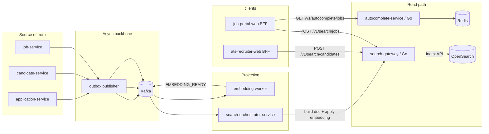

# Search architecture

> **Document type:** Architecture spec for the OpenSearch-backed search subsystem.
> **Audience:** Search engineers (Go gateway, projection service), backend (event producers), platform (capacity planning).
> **Pairs with:** [`packages/shared-contracts/schemas/job-index-document.schema.json`](../../packages/shared-contracts/schemas/job-index-document.schema.json), [`candidate-index-document.schema.json`](../../packages/shared-contracts/schemas/candidate-index-document.schema.json), [`packages/shared-contracts/openapi/recruiter-search-gateway.yaml`](../../packages/shared-contracts/openapi/recruiter-search-gateway.yaml).
> **Engine:** OpenSearch 2.17 (compose) → managed OpenSearch in cloud.

## 1. Topology



- **PostgreSQL is the source of truth.** OpenSearch is a derived read model that can be rebuilt at any time from the source DB plus the Kafka history (or from a one-shot reindex job).
- **Search gateway** is a Go service (`services-go/search-gateway`) — already substantively implemented for jobs.
- **Search orchestrator** consumes events and pushes documents to the gateway's `/internal/v1/index/jobs` endpoint (and the future candidates endpoint).
- **Embedding worker** consumes embedding requests and emits embeddings; the orchestrator merges those into the search document on the next index call (or via partial update).
- **Autocomplete** is Redis-backed sorted sets; the indexer for these keys is to-be-built (see §11).

## 2. Index strategy

| Index | Purpose | Document id | Aliases |
|----|----|----|----|
| `jobs-{env}-v{schema}` | Job search & detail. | `job_id` (UUID) | `jobs` (read); `jobs-write` (write) |
| `candidates-{env}-v{schema}` | Candidate (resume DB) search. | `candidate_id` | `candidates`, `candidates-write` |
| `applications-{env}-v{schema}` (post-MVP) | Recruiter cross-job application views. | `application_id` | `applications`, `applications-write` |

`{env}` = `local`, `dev`, `staging`, `prod`. `{schema}` = increasing integer; bump on breaking mapping changes (see §10 Reindex).

Aliases:
- **Read alias** `jobs` → currently active version. Gateway always queries the read alias.
- **Write alias** `jobs-write` → same as read alias normally; during reindex points to the new version while readers still hit the old.

Settings:
- `index.knn: true` for indices with vector fields.
- `index.refresh_interval`: `1s` for write-heavy bursts during indexing; `5s` default once stable.
- `number_of_shards`: 1 to start (low volume); raise per index as docs/hour exceeds 10k.
- `number_of_replicas`: 0 in local/dev; 1 in staging/prod.

## 3. Job index document (canonical fields)

Field set lives in [`packages/shared-contracts/schemas/job-index-document.schema.json`](../../packages/shared-contracts/schemas/job-index-document.schema.json) (extended in Prompt 10). Highlights:

| Field | Type | Notes |
|----|----|----|
| `tenant_id` | keyword | Mandatory; query filter. |
| `job_id` | keyword | Document id. |
| `organization_id` | keyword | |
| `title` | text + keyword (.raw) | analyzed for search; `.raw` for sorting. |
| `description_text` | text | analyzed; large field. |
| `company_name` | text + keyword (.raw) | |
| `location` | text + keyword (.raw) | composite display string. |
| `country`, `region`, `city` | keyword | structured. |
| `remote_policy` | keyword | enum. |
| `employment_type` | keyword | enum. |
| `salary_min_cents`, `salary_max_cents` | long | nullable. |
| `currency` | keyword | ISO-4217. |
| `experience_min_years`, `experience_max_years` | integer | nullable. |
| `skills` | keyword[] | normalized. |
| `industry` | keyword | |
| `status` | keyword | mostly `PUBLISHED`; closed/draft removed. |
| `published_at` | date | for sort + recency boost. |
| `indexed_at` | date | when projected. |
| `boost_score` | integer | sponsored ranking. |
| `title_vector` | knn_vector dim 768 (target — currently 128) | optional dense embedding. |
| `facets` | object | computed display values (e.g., `salary_band`, `experience_band`). |

Existing gateway uses `title_vector` dim 128 (deterministic stub). When the embedding worker is replaced with a real model, raise to model-native dim (e.g., 768 for `BAAI/bge-base-en-v1.5`) — *this is a breaking mapping change requiring a reindex* (§10).

## 4. Candidate index document

Schema lives in [`packages/shared-contracts/schemas/candidate-index-document.schema.json`](../../packages/shared-contracts/schemas/candidate-index-document.schema.json) (created in Prompt 11). Highlights:

| Field | Type | Notes |
|----|----|----|
| `candidate_id` | keyword | id. |
| `tenant_id` | keyword | nullable for marketplace candidates. |
| `profile_visibility` | keyword | `PUBLIC`, `TENANT_ONLY`, `PRIVATE`. |
| `consent_searchable` | boolean | mandatory query filter (`true`). |
| `tenants_visible_to` | keyword[] | tenant IDs the candidate has consented to be visible to (used when `profile_visibility=TENANT_ONLY`). |
| `full_name` | text + keyword | |
| `title` | text + keyword | candidate-declared current title. |
| `location`, `country`, `region`, `city` | text/keyword | |
| `skills` | keyword[] | aggregated from profile + work experiences. |
| `total_experience_years` | float | computed from work experiences. |
| `education` | nested[] | `{institution, degree, field, ended_at}`. |
| `certifications` | nested[] | `{name, issuer, issued_at}`. |
| `desired_roles` | keyword[] | |
| `salary_expectation_min_cents`, `_max_cents` | long | |
| `currency` | keyword | |
| `availability` | keyword | enum. |
| `resume_text` | text | extracted text from default resume. |
| `embedding_vector_metadata` | object | `{model, dim, computed_at}` (vector itself in `profile_vector`). |
| `profile_vector` | knn_vector | optional. |
| `indexed_at` | date | |

## 5. Query construction

### 5.1 Job search (`POST /v1/search/jobs`)

```text
bool {
  must:    [ multi_match(query) on (title^3, description_text, skills) when query non-empty ]
  filter:  [
    term tenant_id = X-Jobocate-Tenant-Id (mandatory),
    term status = PUBLISHED (default; recruiter-side may pass status filter),
    optional terms employment_type, remote_policy, country, region,
    optional range salary_min_cents.gte | salary_max_cents.lte,
    optional terms skills,
  ]
  should:  [ knn(title_vector) when client supplies vector and dim matches (hybrid boost) ]
}
function_score: {
  field_value_factor: boost_score (modifier=ln1p, factor=1.0)
  decay: published_at gauss (offset=7d, scale=30d)
}
aggs:    [
  terms employment_type, remote_policy, country, region, skills, company_name (top 50),
  histogram salary_min_cents bucket=$10k,
]
highlight: title, description_text
```

**Tenant filter is gateway-enforced**; the client cannot remove it.

### 5.2 Candidate search (`POST /v1/search/candidates`)

```text
bool {
  must:    [ multi_match(query) on (full_name, title^2, skills, resume_text) when non-empty ]
  filter:  [
    term consent_searchable = true (mandatory),
    bool: profile_visibility=PUBLIC OR (profile_visibility=TENANT_ONLY AND tenants_visible_to=tenant),
    optional terms skills,
    optional range total_experience_years,
    optional range salary_expectation_max_cents,
    optional terms country, availability,
  ]
  should:  [ knn(profile_vector) when supplied ]
}
aggs: [
  terms skills, country, availability,
  histogram total_experience_years bucket=2,
]
```

Recruiter-side request always carries the recruiter's tenant; the gateway never trusts a client-side `tenant` filter.

### 5.3 Autocomplete

`autocomplete-service` reads Redis sorted sets keyed `ac:jobs:{tenant}:{prefix}` and `ac:candidates:{tenant}:{prefix}`. Returns top 10 by score.

The **autocomplete writer** is a new lightweight projector (or extension to `search-orchestrator-service`) that:
- Listens to `job.published`, `job.updated`, `job.closed` events.
- Generates 1–3 char prefixes from `title` and stores them with score = `boost_score + recency_decay`.
- Removes prefixes for closed/unpublished jobs.

## 6. Hybrid lexical + vector

- **Lexical is authoritative for filters and recall.** A document not matching the lexical filters is never returned.
- **Vector is a re-ranker / boost.** When a `vector` is supplied in the request, gateway adds a `knn` clause that contributes to the score (default weight 0.5 — tunable via env).
- **Dim mismatch**: the gateway short-circuits the kNN clause when `len(vector) != mapping_dim`; the request still succeeds with lexical only.
- **Embedding generation**: the candidate's profile is embedded by `embedding-worker` (Python). The gateway never calls a model; it only consumes vectors supplied in the request or stored in the document.

## 7. Ranking signals (priority order)

1. **Filters / hard constraints** (tenant, consent, status, location).
2. **Lexical relevance** (BM25 across analyzed fields).
3. **Recency** (gauss decay on `published_at` with 7-day offset, 30-day scale).
4. **Sponsored** (`function_score.field_value_factor` on `boost_score` with `ln1p`).
5. **Vector similarity** (kNN, optional, weight ≤ 0.5 of total).

Sponsored boost is **bounded** — a sponsored job ranking above an unsponsored one due to boost_score must be visibly labeled in the UI ("Sponsored").

## 8. Tenant filtering (non-negotiable)

- Every query SHALL include `term: tenant_id = <X-Jobocate-Tenant-Id>` as a `filter` (not `must`) clause, added by the gateway *after* parsing the client request.
- Public marketplace search uses a separate `/v1/search/jobs/public` route that has no tenant filter but enforces `status=PUBLISHED` and excludes recruiter-only fields from response projection.
- Internal indexing endpoints (`/internal/v1/index/...`) require an internal token but still write `tenant_id` into the document; future protection: switch from a static token to mTLS or a service identity JWT.

## 9. Consent filtering (candidates)

- Mandatory `term: consent_searchable = true`.
- For non-public visibility:
  - `profile_visibility=PUBLIC`: visible to all tenants.
  - `profile_visibility=TENANT_ONLY`: only tenants in `tenants_visible_to` see the candidate.
  - `profile_visibility=PRIVATE`: removed from index entirely (dropped on consent revoke).
- Consent revoke triggers `candidate.consent_changed` event → projector deletes the document (or sets `consent_searchable=false`) within ≤ 60 seconds.

## 10. Index refresh and reindex

### 10.1 Refresh during writes
- Indexer (`/internal/v1/index/jobs`) currently uses `refresh: true` on each write. **For low write volume this is fine.** Above ~100 writes/min, switch to `refresh_interval: 1s` and remove the per-write refresh to avoid segment thrash.

### 10.2 Bulk reindex (mapping change)
1. Create new index `jobs-{env}-v{n+1}` with new mapping.
2. Point `jobs-write` alias to v{n+1}; `jobs` (read) still on v{n}.
3. Run `reindex-tool` (Go CLI) to copy v{n} → v{n+1} (using `_reindex` API) while live writes also flow into v{n+1} via alias.
4. When v{n+1} caught up (compare doc counts and tail), atomically swap `jobs` alias to v{n+1}.
5. Drop v{n} after a soak period.

The current `reindex-tool` is a flag-parsing stub (per audit); Prompt 17/18 includes a real implementation.

### 10.3 Backfill from PG
- A one-off script (or reindex-tool subcommand) reads source rows from PG and posts to `/internal/v1/index/...` in batches. Use Kafka pause/resume to avoid duplicate writes during backfill.

## 11. Kafka-driven indexing flow

| Event | Producer | Consumer | Action |
|----|----|----|----|
| `job.published` | `job-service` | `search-orchestrator-service` | Build `JobSearchDocument` from Postgres + cached company info; POST to gateway `/internal/v1/index/jobs`. |
| `job.updated` | `job-service` | `search-orchestrator-service` | Same as above. |
| `job.closed` / `job.archived` / `job.unpublished` | `job-service` | `search-orchestrator-service` | DELETE from index (or set `status` and rely on filter). |
| `candidate.profile_changed` | `candidate-service` | `search-orchestrator-service` | If `consent_searchable=true`, build candidate doc and index; else delete. |
| `candidate.consent_changed` | `candidate-service` | `search-orchestrator-service` | Same logic. |
| `resume.parsed` | `resume-parser-worker` | `search-orchestrator-service` | Update `resume_text` field on candidate doc. |
| `embedding.ready` | `embedding-worker` | `search-orchestrator-service` | Update `title_vector` (job) or `profile_vector` (candidate) via partial update. |
| `application.submitted` / `.stage_changed` | `application-service` | `search-orchestrator-service` (post-MVP) | Maintain `applications-{env}` index for recruiter cross-job views. |
| Autocomplete events | `job-service` (job lifecycle) | autocomplete-writer | Maintain Redis sorted sets. |

**Failure handling**:
- Retries with exponential backoff (3 immediate, then DLQ).
- DLQ topic per source (`jobocate.search.dlq`) with replay tooling.
- Consumer offsets tracked per group.

## 12. Latency SLOs

| Operation | P50 | P95 | P99 |
|----|----|----|----|
| `POST /v1/search/jobs` (warm) | 50 ms | 250 ms | 500 ms |
| `POST /v1/search/candidates` (warm) | 80 ms | 400 ms | 800 ms |
| `GET /v1/autocomplete/jobs` | 5 ms | 50 ms | 100 ms |
| Index document end-to-end (event → searchable) | 1 s | 5 s | 30 s |
| Consent revoke → candidate removed | 5 s | 60 s | 120 s |

Operational concerns: connection pooling on the gateway, OpenSearch heap sized to ≥ 50% of available memory (within JVM defaults), monitoring on `search.query.took_ms` histogram.

## 13. Response normalization

The gateway always returns a normalized envelope (per `recruiter-search-gateway.yaml`) so downstream clients are insulated from OpenSearch's raw shape:

```json
{
  "total": { "value": 2, "relation": "eq" },
  "hits": [ { "id": "...", "score": 4.2, "highlight": {...}, "document": {...} } ],
  "facets": { "employment_type": [ { "value": "FULL_TIME", "count": 12 } ], ... }
}
```

The `document` field is the OpenSearch `_source`; the gateway may strip recruiter-only fields when serving the public search endpoint.

## 14. Sponsored slots (FR-17.7 / FR-19.6)

- `boost_score INT` on the document (0 = none).
- Function score adds `ln1p(boost_score)` to BM25 score.
- A maximum boost cap (env: `JOBOCATE_MAX_BOOST=10`) prevents a single sponsor monopolizing top results.
- The frontend MUST visually label any hit returned with `boost_score > 0` as "Sponsored".

## 15. Failure handling and degraded modes

| Failure | Behavior |
|---------|----------|
| OpenSearch unreachable | Gateway returns 503 `DOWNSTREAM_UNAVAILABLE`. Frontend shows "Search is temporarily unavailable. Try again." |
| Partial result (timeouts on aggregations) | Hits returned; facets omitted with `"facets_partial": true`. |
| Indexer falls behind | Notification SLO breached; on-call alerted via consumer-lag alert (Prom rule). |
| DLQ accumulating | Alert; dashboard panel in Grafana; runbook in `15-observability/runbooks/`. |
| Reindex in progress | Read alias unaffected; write alias double-writes; if backfill fails, abort and re-point write alias back. |

## 16. Security posture

- **Local**: HTTP only to OpenSearch (`http://opensearch:9200` in compose). Internal network only.
- **Cloud**: TLS to OpenSearch with IAM auth (AWS) or basic auth + TLS (managed providers). The gateway requires TLS to the upstream and certificate verification on.
- **Internal token**: `X-Internal-Token` is a static secret today. Roadmap: replace with mTLS or a short-lived service token (signed JWT).
- **PII in indices**: candidate index stores `email` and `phone` only when consent allows; for non-consenting candidates these fields are excluded by the projector.

## 17. As-is gaps (vs this spec)

| Gap | Where |
|---|---|
| Candidate index does not exist | `search-gateway` only ensures jobs index; needs a `candidates` index ensure step. |
| Bulk index endpoint missing | `/internal/v1/index/jobs/bulk` to be added. |
| Public search route missing | `/v1/search/jobs/public` not implemented. |
| Autocomplete writer does not exist | Sorted set keys are populated only by manual / external means today. |
| `reindex-tool` is a stub | Replace with real Reindex API + alias swap. |
| OpenSearch authentication not configured | Local only; production requires TLS + auth. |
| Vector dim is 128 (deterministic stub) | Raise to model-native dim once real embedding model is wired. |
| DLQ topic not declared | Add `jobocate.search.dlq` and consumer error handlers. |
| Recency decay and function_score not yet in gateway | Add to `buildJobsSearchBody`. |
