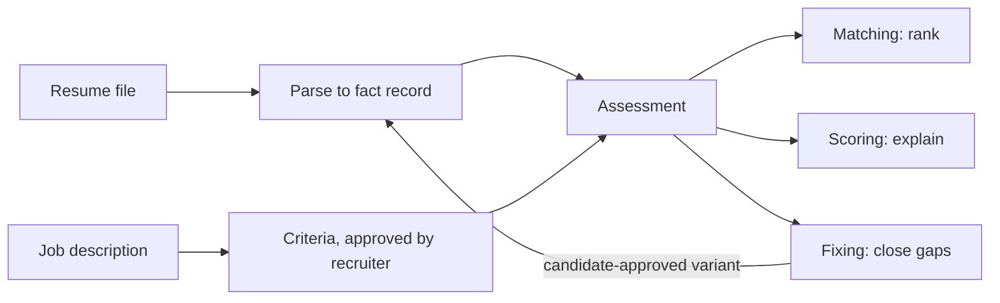
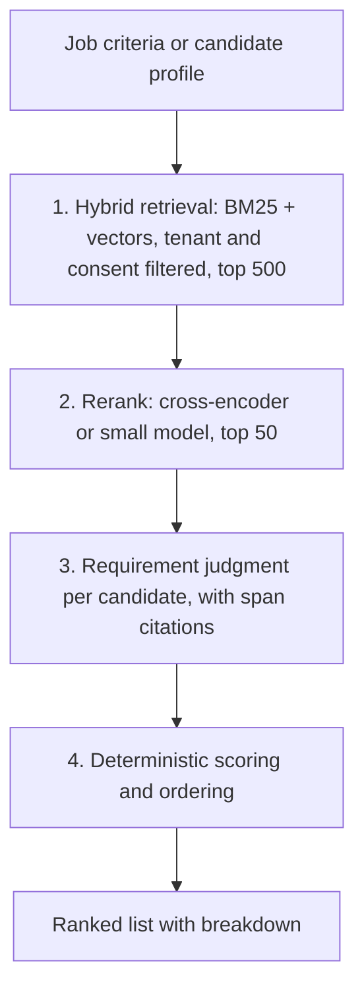
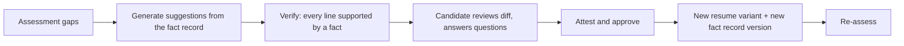

# Design — matching, resume scoring and resume fixing

> **Document type:** System and experience design for product pillars 4.1–4.3 of the
> [product outline](../01-product/prd.md).
> **Status:** Proposal for tech-lead and AI-owner review. Nothing here is built. **Jira:** IATS-132.
> **Change classes when implemented:** AI, Contract, Data, Security, Product.
> **Builds on:** [`ai-artifact-platform.md`](./ai-artifact-platform.md),
> [`../06-search-engine/search-architecture.md`](../06-search-engine/search-architecture.md), epics
> E05 (IATS-4), E13 (IATS-14) and E17 (IATS-82).
> **Evidence for the choices:** [`market-and-competitive-research.md` §5](../01-product/market-and-competitive-research.md).

## 1. The core idea

All three features read one thing: an **assessment** of one resume version against one job's
criteria. Matching sorts by it, scoring displays it, and fixing works on its gaps.

Two rules shape everything else:

1. **The model judges evidence; code computes scores.** The model answers a narrow question per
   requirement ("is this demonstrated, and where?") and must point at text. Aggregation into scores
   is deterministic code, so a score can be reproduced and explained.
2. **Nothing the model outputs changes a candidate's state.** Assessments are advisory records.
   Only a person with the right role moves an application.



## 2. Building blocks

### 2.1 Fact record (owner: `candidate-service`)

Parsing produces a structured record, replacing today's regex output.

- **Contents:** roles (employer, title, dates, bullets), education, certifications, skills, each
  with `source_spans` (page and character offsets into the visible text) and `origin`:
  `PARSED`, `CANDIDATE_EDITED` or `CANDIDATE_ATTESTED`.
- **Two views of one record:**
  - *Identity view:* name, contact details, photo, address, dates of birth and graduation.
  - *Evaluation view:* everything else. Only this view is sent to any scoring or ranking model.
- **Visible-text check.** The parser renders each page to an image, reads it with OCR, and compares
  that with the embedded text layer. Text present in the file but not visible on the page is stored
  as `hidden_text`, excluded from the evaluation view, and shown to the recruiter as a neutral flag
  ("this file contains text that is not visible"). It never lowers a score by itself.
- **Extraction method.** Layout-aware text plus OCR, then schema-constrained extraction where the
  model returns span pointers, not regenerated text. A span that does not exist in the visible text
  is discarded. A commercial parser remains an option as a cross-check; the choice belongs to
  IATS-107.
- **Skills.** Each skill maps to a canonical skill ID (IATS-97). Skills are stored as `explicit`
  (written in the resume) or `inferred` (implied by a role). Inferred skills can help ranking but
  never satisfy a must-have.

### 2.2 Job criteria (owner: `job-service`)

- A versioned list of requirements per job. Each has `id`, `text`, `kind` (`MUST_HAVE`,
  `NICE_TO_HAVE`), `weight`, `type` (`SKILL`, `EXPERIENCE`, `CREDENTIAL`, `ELIGIBILITY`), and
  optional canonical skill IDs.
- AI drafts criteria from the job description; a recruiter edits and **approves** them. Only an
  approved version can be used for assessment (IATS-32).
- `ELIGIBILITY` items (work authorisation, licence, location) are checked against application
  answers, not inferred from the resume.
- A lint step warns on criteria that are likely proxies for protected traits: age or
  graduation-year limits, "native speaker", "no gaps", named schools.
- Prerequisite: job skills must be persisted, which they are not today (as-is §3.3).

### 2.3 Assessment (owner: `application-service`)

One row per `(tenant_id, resume_version_id, job_id, criteria_version, rubric_version, model_config_version)`.
That tuple is also the cache key, so an unchanged pair is never re-scored.

```
assessment
  id, tenant_id, job_id, candidate_id, resume_version_id, application_id (nullable)
  criteria_version, rubric_version, taxonomy_version, model_config_version, prompt_version
  status            REQUESTED | READY | FAILED | SUPERSEDED
  requirement_results  [{requirement_id, level 0-3, confidence, spans[], note}]
  dimension_scores     {coverage, evidence, recency, seniority, impact, parseability}
  must_have_gaps       [requirement_id]
  overall              0-100
  flags                [HIDDEN_TEXT, LOW_PARSE_CONFIDENCE, AI_ASSISTED_VARIANT, ...]
  audience             RECRUITER | CANDIDATE | BOTH
  created_at
```

Assessments are append-only. A new version supersedes the old one; the old one stays for audit.

## 3. Scoring rubric

### 3.1 Per-requirement evidence level

The model assigns one level per requirement and must cite spans for levels 1–3.

| Level | Meaning |
|---|---|
| 0 | Not found |
| 1 | Mentioned (for example in a skills list) with no context |
| 2 | Demonstrated in a described role or project |
| 3 | Demonstrated with substantial duration, recency or measurable outcome |

Code then validates every cited span against the evaluation view and downgrades any result whose
spans do not exist.

### 3.2 Dimensions

| Dimension | Computed from | Notes |
|---|---|---|
| **Requirement coverage** | Weighted share of requirements at level ≥ 1, must-haves and nice-to-haves reported separately | |
| **Evidence strength** | Weighted mean level across covered requirements | Separates "listed" from "did" |
| **Recency** | Dates of the roles that supply the evidence | Measures recency of the *skill*, never gaps in employment |
| **Seniority fit** | Scope signals in the evidence versus the job level | Team size, ownership, complexity; not years since graduation |
| **Quantified impact** | Share of evidence bullets with a measurable outcome | |
| **Parseability** | Parse confidence, layout problems, hidden text | Shown mainly to the candidate |

`overall` is a weighted sum with tenant-adjustable weights inside fixed bounds. The interface always
shows the breakdown; the single number never appears alone.

**Never used as features:** name, photo, address or postcode, age, graduation year, employment gaps,
tenure length patterns, school prestige, or any data not supplied by the candidate.

### 3.3 Must-have gaps

A must-have at level 0 does not reduce the candidate to zero and does not hide them. It is listed as
"not found in resume — confirm with candidate", and the candidate sees the same line, which is what
the fixer turns into a question.

## 4. Matching pipeline

Two entry points use different amounts of the pipeline.

| Use | Who is assessed | Stages |
|---|---|---|
| **Applicant review** for a job | **Every** applicant, in full | 3 and 4 only. No applicant is dropped by an earlier, cheaper stage, so all are treated alike |
| **Sourcing and rediscovery** from the talent pool; **jobs for a candidate** | Top results only | 1 → 2 → 3 → 4 |



- **Stage 1** runs in `search-gateway` against a new candidate index (the schema exists; mapping,
  indexer and endpoint do not). Filters for tenant, consent and visibility are applied by the
  gateway from the authenticated identity, never from request input.
- **Stage 2** is a reranker behind the AI gateway. Target: under 800 ms at P95 for 200 candidates,
  as IATS-108 states.
- **Stage 3** is the only large-model step. It runs asynchronously through the existing artifact
  pipeline and is cached by the assessment key.
- **Stage 4** is code.
- **Ordering:** by `overall`, with ties broken by application time. A recruiter can re-sort by any
  dimension.
- **Learning from feedback (later):** recruiter decisions are logged as labels but are not used to
  train ranking until they have been checked for bias. Engagement signals are known to favour brand
  names.

## 5. Resume fixing pipeline



| Suggestion type | Example | Guard |
|---|---|---|
| **Rephrase** | Clearer wording of an existing bullet | Must be supported by the source bullet |
| **Surface** | Move relevant existing evidence higher | No new content |
| **Quantify** | "Roughly how many users did this serve?" | A question; the number comes from the candidate |
| **Gap question** | "The role asks for Kafka. Have you used it? Where?" | Added only after an answer; stored as `CANDIDATE_ATTESTED` |
| **Format** | Single column, standard headings, remove text in images | Offered separately from content |

Controls:

- **Verification pass.** A second, independent check tests each proposed line against the fact
  record. Unsupported lines are dropped before the candidate sees them. Release testing requires
  zero unsupported lines on the test set.
- **No keyword insertion.** The fixer never adds a term the fact record does not support.
- **Attestation.** Before a variant can be attached to an application, the candidate confirms it is
  accurate. This uses the existing `RESUME_VARIANT` artifact with `review_required=true`; the server
  must stop callers overriding that flag (as-is §3.1 item 4).
- **Provenance to the recruiter.** A variant carries an `AI_ASSISTED_VARIANT` flag and a link to the
  original. Attested additions are marked.
- **Rendering.** Variants are rendered from the structured record with a plain, single-column
  template to DOCX and PDF, stored under the candidate's tenant-scoped storage path.
- **Consent.** Fixing is opt-in per candidate and honours the existing AI opt-out setting.

## 6. Services, contracts and data

| Component | Change | Backlog |
|---|---|---|
| **AI gateway** (new) | Single path for every model call: provider routing and fallback, PII redaction, per-tenant quotas, cost and latency logging, prompt and model version stamping | IATS-104, IATS-105, IATS-109 |
| `resume-parser-worker` | Replace regex parsing with fact-record extraction and the visible-text check | IATS-107 |
| `embedding-worker` | Real embedding model; new index version | IATS-106 |
| `candidate-service` | Fact record versions, origins, identity and evaluation views | IATS-29 |
| `job-service` | Persist skills; criteria versions and approval | IATS-32 |
| `application-service` | `assessment` table and API; role checks; artifact review-flag enforcement | IATS-31, IATS-33, IATS-34 |
| `search-gateway` | Candidate index, `POST /v1/search/candidates`, JWT validation | IATS-26, IATS-28 |
| New worker `assessment-worker` | Requirement judgment and fixer generation, called through the gateway | IATS-108 |

**Proposed API (to be written as OpenAPI first):**

```
POST /api/v1/jobs/{jobId}/criteria                    draft or edit criteria
POST /api/v1/jobs/{jobId}/criteria/{version}/approve  recruiter approval
POST /api/v1/assessments                              {jobId, resumeVersionId}  → 202
GET  /api/v1/assessments/{id}
GET  /api/v1/jobs/{jobId}/assessments?sort=overall    ranked applicants
POST /api/v1/assessments/{id}/evidence-reports        "this evidence is wrong"
GET  /api/v1/me/assessments/{id}                      candidate view
POST /api/v1/me/resumes/{id}/fix-sessions             start fixing against a job
POST /api/v1/me/fix-sessions/{id}/answers             answer gap questions
POST /api/v1/me/fix-sessions/{id}/approve             attest → new variant
```

**Events:** a new topic `jobocate.assessment.events` (`assessment.requested`, `.ready`, `.failed`,
`.superseded`), published through the outbox and registered in `kafka/topics.yaml` along with the
currently missing `jobocate.ai.artifact.events`.

**Tenancy:** assessments, vectors, caches and prompts are all keyed by tenant. Vector queries carry
a mandatory tenant filter. There is no cross-tenant learning. Embeddings are treated as personal
data and are deleted with the candidate.

## 7. Safety design

| Risk | Control |
|---|---|
| Prompt injection in resume text | Resume text is passed as delimited data; scoring calls have no tools; output must match a schema; cited spans are validated in code |
| Hidden text and keyword stuffing | Visible-text check (§2.1); evidence levels require context, so a bare keyword list earns level 1 at most |
| Bias through names and similar signals | Evaluation view (§2.1); banned features (§3.2); criteria lint (§2.2) |
| Automation bias in reviewers | Evidence shown before the score; a reason is required to reject a high-ranked or advance a low-ranked candidate; a random sample of unranked reviews for audit |
| Scorer favouring our fixer's output | Self-preference test on every release (§8) |
| Fabricated resume content | Fact-bounded generation, verification pass, attestation (§5) |
| PII leaving the tenant | Redaction at the gateway; identity view never sent to scoring models |
| Unexplained scores | Per-requirement results with spans stored for every assessment |
| Uncontrolled cost | Assessment cache; batch processing for backfills; small model first, larger model only where confidence is low |

## 8. Evaluation and release gates

A model, prompt, rubric or taxonomy change ships only if all of these pass. The thresholds are set
in IATS-75 and IATS-61.

| Gate | Method |
|---|---|
| **Extraction quality** | Per-field F1 on a labelled, synthetic resume set |
| **Ranking quality** | NDCG@10 and recall@50 on a set labelled by at least two recruiters with an adjudication guide |
| **Judgment agreement** | Agreement between model evidence levels and human labels, per requirement type |
| **Counterfactual fairness** | Swap names, pronouns and school names on otherwise identical resumes; scores must not move beyond a set tolerance |
| **Adverse impact** | Selection-rate ratios by group on the test set, 0.80 as the floor; the same metric monitored per tenant in production |
| **Self-preference** | Equivalent human-written and fixer-written resumes must score the same within tolerance |
| **Fabrication** | Zero unsupported lines from the fixer on the test set |
| **Injection** | A suite of hidden-text and instruction attacks; none may change a score |

Test data is synthetic. No real resumes are committed, per repository rules.

In production: score distribution drift per tenant and job family, recruiter override rate, evidence
reports from candidates and recruiters, and a bias-audit export in the format NYC Local Law 144
audits use.

## 9. Experience design

### 9.1 Recruiter: applicant review

```
┌ Senior Backend Engineer · 142 applicants · criteria v3 (approved) ──────────────┐
│ Sort: Overall ▾   Filter: must-haves met ☐   flags ☐                            │
├──────────────────────────────────────────────────────────────────────────────────┤
│ ▸ Candidate A                                         AI-generated · advisory   │
│   Must-haves 4/5   Nice-to-haves 3/4                                             │
│   ✔ Java, 6 yrs      "Led migration of billing service to Java 17…"   [p1]      │
│   ✔ Kafka            "Built event pipeline handling 2M msgs/day"      [p1]      │
│   ? Kubernetes       Not found in resume — confirm with candidate               │
│   Coverage ████▁  Evidence ████▁  Recency █████  Impact ███▁▁     Overall 78    │
│   [Open resume]  [Report wrong evidence]  [Advance]  [Reject…]                  │
└──────────────────────────────────────────────────────────────────────────────────┘
```

- Evidence lines come first; the overall number is last and smallest.
- Clicking a citation opens the resume at that line.
- "Reject…" always asks for a disposition reason. If the candidate is in the top quartile, it also
  asks for a short note.
- Keyboard: `j`/`k` to move, `e` to expand evidence, `a` to advance. Bulk reject is available only
  for candidates the recruiter has opened.

### 9.2 Candidate: score and fix

```
┌ Your fit for Senior Backend Engineer at Acme ───────────────────────────────────┐
│ This is the same assessment the hiring team sees.            How this works ⓘ  │
│ Strong: Java, event-driven systems, team leadership                             │
│ Gaps:   Kubernetes (not found)   Impact (2 of 9 bullets have numbers)           │
│ Format: 2 issues (two-column layout, text inside an image)                      │
│                                              [Improve my resume for this job]   │
├──────────────────────────────────────────────────────────────────────────────────┤
│ Question 1 of 3: The role asks for Kubernetes. Have you used it?                │
│  ( ) Yes — tell us where    ( ) No    ( ) Skip                                  │
├──────────────────────────────────────────────────────────────────────────────────┤
│ − Worked on billing system migration                                            │
│ + Led migration of the billing service to Java 17, cutting p95 latency 40%      │
│   Based on: your original bullet + your answer "about 40%"   [Accept] [Edit] [✕]│
└──────────────────────────────────────────────────────────────────────────────────┘
│ ☐ I confirm everything in this version is accurate.          [Save version]     │
```

- "No" to a gap question is a valid answer; the tool then suggests how to present adjacent
  experience honestly or says plainly that the gap remains.
- Every suggestion shows what it is based on.
- The candidate can request a human review of their assessment and report wrong evidence.

### 9.3 States every screen needs

Loading (assessment in progress, typically seconds to a minute), failed (retry, and the application
is unaffected), low parse confidence (ask the candidate to check extracted fields), AI disabled for
the tenant or opted out by the candidate (the plain resume and manual review still work).

## 10. Delivery order

| Step | Deliverable | Depends on |
|---|---|---|
| 1 | Fix identity, roles and the artifact review flag; fix worker callback fields and event inputs | As-is §3 |
| 2 | AI gateway with one provider, redaction, logging | IATS-72 decision |
| 3 | Fact-record parsing and visible-text check | 2 |
| 4 | Job skills, criteria versions and approval | 1 |
| 5 | Assessment for applicants with the recruiter review screen | 3, 4 |
| 6 | Evaluation set and release gates wired into CI | 5; IATS-75 |
| 7 | Candidate index, real embeddings, retrieval and rerank for rediscovery | 2 |
| 8 | Candidate score view | 5 |
| 9 | Fixer with verification and attestation | 8 |
| 10 | Jobs-for-candidate matching | 7 |

Step 6 must be complete before any tenant outside a controlled pilot sees a score.

## 11. Open questions

1. Provider and model tiers for judgment, reranking and embeddings (IATS-72, IATS-106).
2. Build or buy the parser, or run both and compare (IATS-107).
3. Which skills taxonomy to anchor on; licence terms need checking (IATS-97).
4. Who may see the candidate's assessment before applying: the product-owner decision in the outline
   §11.
5. Whether tenants may adjust dimension weights, and within what bounds.
6. Retention period for assessments. Research suggests four years as the safe default; needs
   counsel (IATS-76).
7. Who approves an AI action with candidate impact. `full-sdlc.md` lists this as a stop condition
   until the product owner defines it.
