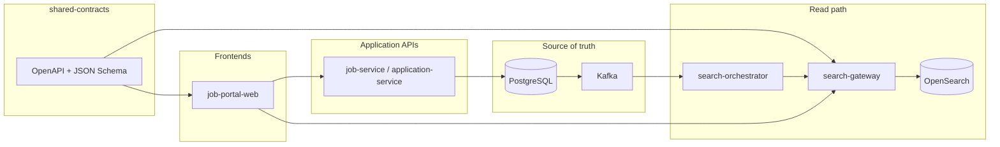

# Implementation plan

This document turns the product scope in [`portal-parity-roadmap.md`](portal-parity-roadmap.md) into an **engineering execution plan**: ordering, dependencies, exit criteria, and how teams align across the monorepo.

---

## Guiding principles

1. **Contracts before code** — Publish OpenAPI / JSON Schema changes in `packages/shared-contracts` first; bump versions; regenerate or hand-update `packages/api-sdk` before UI ships against new APIs.
2. **Tenant isolation is non-negotiable** — Every API, query, and search request is scoped by `tenant_id` (JWT, headers where dev-only, OpenSearch filters). Integration tests must include **wrong-tenant → empty/403** cases (see [`testing-strategy.md`](../16-devops/testing-strategy.md)).
3. **Search is a derived read model** — PostgreSQL remains source of truth; index updates flow through Kafka/projections (`search-orchestrator-service`, `search-gateway`). No “fix the index by hand” in prod without a runbook.
4. **Thin vertical slices** — Prefer one end-to-end slice (e.g. “SERP calls gateway with one facet”) over parallel half-done layers.

---

## Program phases (mapped to roadmap)

| Phase  | Roadmap reference                         | Primary outcome                                                                | Key packages / services                                                                                         |
| ------ | ----------------------------------------- | ------------------------------------------------------------------------------ | --------------------------------------------------------------------------------------------------------------- |
| **A**  | Search & discovery parity                 | Documented search contract + working hybrid search + job SERP/detail in portal | `shared-contracts`, `search-gateway`, `search-orchestrator-service`, `job-service`, `job-portal-web`, `api-sdk` |
| **B**  | Candidate, applications, alerts           | Auth shell, apply flow, application history, saved search + notifications      | `tenant-auth-service`, `candidate-service`, `application-service`, `notification-service`, `job-portal-web`     |
| **B+** | AIApply-class copilot                     | Draft resume/cover per job, review queue, optional batch submit with caps      | `workers-python`, `application-service`, S3 artifacts, `job-portal-web`, `admin-service` (quotas)               |
| **C**  | Recruiter ATS depth                       | Pipeline UI, stages, candidate packet                                          | `ats-recruiter-web`, `ats-core-service`, `application-service`                                                  |
| **D**  | Differentiation (e.g. cover note / boost) | Policy-driven visibility; audited                                              | `application-service`, `job-service`, index ranking hooks                                                       |
| **E**  | Resume DB & enterprise                    | Opt-in candidate index, enterprise hooks                                       | New index alias, `candidate-service`, `tenant-auth-service`, infra docs                                         |

Phases **A → B** are the critical path for a credible marketplace demo; **B+** can start after apply payloads and S3 resume paths are stable.

---

## Dependency graph (simplified)



Frontends should call **BFF or public API** as you define it; avoid embedding OpenSearch credentials in the browser. Prefer server-side route handlers or a small API layer that forwards to `search-gateway` with service auth.

---

## Milestones and definition of done

### Milestone A1 — Search contract frozen

- **DoD:** `recruiter-search-gateway.yaml` lists all supported `filters` keys and example responses (hits + facets). `job-index-document.schema.json` matches fields emitted by projection.
- **Verify:** CI or script validates OpenAPI; sample `curl` against gateway documented in README or this doc’s appendix.

### Milestone A2 — Facets in gateway

- **DoD:** `POST /v1/search/jobs` applies filters and returns at least one aggregation (e.g. `employment_type`).
- **Verify:** Integration test or manual compose run with seeded index.

### Milestone A3 — Portal SERP

- **DoD:** `job-portal-web` has `/jobs` and `/jobs/[id]` (or equivalent) using env-configured base URL; loading/error/empty states; keyboard-accessible filters.
- **Verify:** `pnpm --filter @jobocate/job-portal-web lint` + `build` green.

### Milestone B1 — Apply happy path

- **DoD:** Authenticated user can submit one application; duplicate apply handled; timeline visible.
- **Verify:** Test per [`testing-strategy.md`](../16-devops/testing-strategy.md) for tenant isolation.

---

## Suggested first three sprints (example)

| Sprint | Focus             | Deliverables                                                                                             |
| ------ | ----------------- | -------------------------------------------------------------------------------------------------------- |
| **1**  | Contracts + index | Extend OpenAPI + schema; align `search-gateway` mapping; orchestrator emits new fields; reindex tool doc |
| **2**  | Gateway + seed    | Facet parsing + aggregations; Flyway seed diversity; demo `curl`/Bruno collection                        |
| **3**  | Portal SERP       | `api-sdk` search client; `/jobs` UI; feature flag for gateway URL                                        |

Adjust lengths to team size; keep **shared-contracts** PRs small and reviewable.

---

## Local setup (developer checklist)

1. **Infra:** `docker compose -f infra/docker/docker-compose.yml up -d` (see root [README](../../README.md)).
2. **Env:** [environment-variables.md](../16-devops/environment-variables.md) + `.env.example`.
3. **Node:** `pnpm install` at repo root; use Node 20+ and Corepack-enabled pnpm 9 (see README if Corepack errors).
4. **Java:** Flyway order respected (`ats-core-service` before `job-service` for demo tenant).
5. **Search:** Run `search-gateway` locally; confirm health + sample search against OpenSearch.

---

## Roles and ownership (RACI-style, lightweight)

| Area                | Owns “what ships”                | Consulted                  |
| ------------------- | -------------------------------- | -------------------------- |
| API contracts       | Platform / backend lead          | Frontend, search           |
| OpenSearch mappings | Search (Go)                      | Java projection owners     |
| Job seeker UX       | Frontend + design                | Product, legal for AI copy |
| Tenant & auth       | Security + `tenant-auth-service` | All service owners         |

---

## Appendix — verify search gateway (Milestone A1–A2)

With OpenSearch and `search-gateway` running (`SEARCH_GATEWAY_URL` / `HTTP_ADDR` defaults in [environment-variables.md](../16-devops/environment-variables.md)):

```bash
curl -sS -X POST "http://localhost:7070/v1/search/jobs" \
  -H "Content-Type: application/json" \
  -H "X-Jobocate-Tenant-Id: 11111111-1111-1111-1111-111111111111" \
  -d '{"query":"","limit":25}' | jq .
```

After indexing jobs (Kafka projection or internal index POST), the JSON body should include **`total`**, **`hits`** (with `document`), and **`facets.employment_type`** / **`facets.remote_policy`** bucket arrays.

---

## Related documents

- [`portal-parity-roadmap.md`](portal-parity-roadmap.md) — capability matrix and phased product scope.
- [`ui-coding-standards.md`](../16-devops/ui-coding-standards.md) — UI and code style for implementation consistency.
- [`testing-strategy.md`](../16-devops/testing-strategy.md) — how to test each layer.
- [`environment-variables.md`](../16-devops/environment-variables.md) — configuration.
